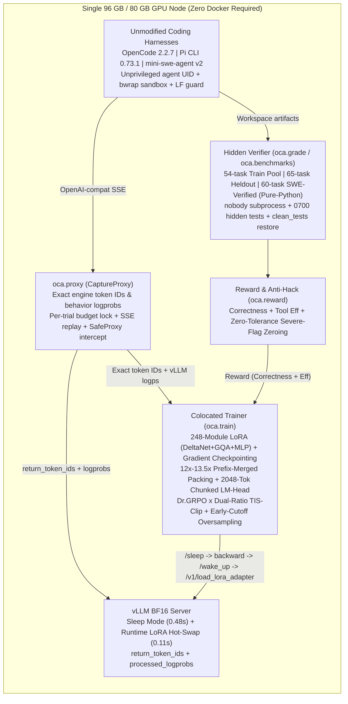

# OpenCode & Pi Harness Adapter

Single-GPU colocated Agentic Reinforcement Learning (**248-module LoRA `r=32`**) that adapts a lightweight open-weight model (`Qwen/Qwen3.5-9B`, non-thinking mode) to operate unmodified terminal coding harnesses (**OpenCode 2.2.7**, **Pi 0.73.1**, and zero-shot OOD transfer to **mini-swe-agent v2**) — validated across **11,220 paired rollout trials (0 errored trials)** spanning **5 benchmark suites**. Without cherry-picking per-suite winners, the most balanced adapter (`soup_v5_pi_qr_svd`) lifts the **5-suite mean from `33.12% → 44.27%` (`+11.15 pp`)**, outperforming Base on every suite (single-suite peaks reach `43.33%` on our zero-Docker 60-task `SWE-bench_Verified` pure-Python subset on Pi and `45.83%` on OpenCode).

- 📖 **Visual Technical Report (中文完整报告)**: [docs/V5_EXPLAINER_ZH.md](docs/V5_EXPLAINER_ZH.md)
- 📄 **Full V5 Technical Report (English)**: [docs/V5_REPORT_EN.md](docs/V5_REPORT_EN.md)
- 🤗 **HuggingFace Weights & Reports**: [`XDE10/Qwen3.5-9B-Harness-Adapters-v5`](https://huggingface.co/XDE10/Qwen3.5-9B-Harness-Adapters-v5)

Inspired by Hugging Face's *Harness Adapters* (Nov 2026), this repository replaces multi-GPU asynchronous clusters (e.g., 2×B200 + Docker/Harbor) with a self-contained **single 96 GB GPU** (RTX PRO 6000 Blackwell on Colab G4) loop featuring **0.48s vLLM Sleep offload**, **0.11s runtime LoRA hot-swap**, **12×–13.5× Prefix-Merged Multi-Turn Packing**, **Exact Chunked LM-Head Backward** (for 248K vocab), and **Dual-Ratio `Dr.GRPO × TIS-Clip`** engine-mismatch calibration.

---

## V5 Visual Overview & Headline Results (11,220 Paired Trials, 0 Errors)

| Visual Explainer | Key Takeaway |
| --- | --- |
|  | **Single-GPU Colocated RL Loop**: 54-task multi-file pool (`SWE-smith-py` + L2 + L1), 248-module LoRA (DeltaNet + GQA + MLP), `0.48s` Sleep, `0.11s` LoRA hot-swap, `~39 GB` peak training VRAM. |
|  | **5-Suite Leaderboard & Negative Super-Adapter Finding**: Balanced 5-suite mean climbs **`33.12% → 44.27%`** (`soup_v5_pi_qr_svd`, beating Base on all 5 suites and rescuing `v5_pi_seed2`'s `SWE-OC` drop from `32.5% → 40.0%`); **`+10.0–12.3 pp`** zero-shot on unseen `mini-swe-agent`. Equal-weight cross-harness `super_*` (`40.76%–42.45%`) do not beat single-harness Pi (`43.55%`) or Same-Harness Soup (`44.27%`). Note: our zero-Docker 60-task `SWE-bench_Verified` subset covers `django` (36), `sympy` (22), and `requests` (2) with capped `p2p[:25]`. |
|  | **4-Way Algorithm Ablation & GSPO Prefix-Shattering Observation**: On `pi_heldout` (single seed), `Dr.GRPO+TIS` (`47.31%`) > `CISPO` (`46.15%`, shortest tokens) > `Turn-Credit` (`45.77%`, fewest turns) > `GSPO` (`43.85%`, n.s.). Sequence-level `GSPO` slows backward passes **5–6× (`180s → 1,177s`, `29 → 238` segments)**, hypothesized to stem from redundant `</function></function>` tags canonicalized on the next turn (pending clean-tag retrain verification). |
|  | **248-Module Weight ($\Delta W$) vs Activation ($\Delta h$) Analysis**: Near-zero weight cosine (`+0.0001`) is demonstrably a **LoRA-A init-seed artifact**, not cross-harness orthogonality (same-harness diff-seed is also `+0.0001`, vs `+0.0180` same-seed cross-harness). Activation cosine over 16 prompts shows a modest positive shift (`mean +0.0308`, median `+0.0155`, DeltaNet `+0.0456` > MLP `+0.0134`; small absolute magnitude, not claiming strong alignment). |

### V5 5-Benchmark Master Table (`Pass@1`, Task-Level Permutation `p`, 0 Errored Trials)

| Adapter / Method (`Qwen3.5-9B`, 248-mod LoRA `r=32`) | **5-Suite Mean** | Pi Heldout *(65×4)* | OC Heldout *(65×4)* | OOD `mini-swe` *(65×2)* | SWE-Verified Pi *(60×2)* | SWE-Verified OC *(60×2)* |
| --- | :---: | :---: | :---: | :---: | :---: | :---: |
| `Base Qwen3.5-9B` (Non-Thinking) | `33.12%` | `36.92%` | `38.85%` | `32.31%` | `23.33%` | `34.17%` |
| `v5_pi_seed2` (Pi RL, seed 2) | **`45.22%`** | **`56.15%`** *(p=0.0001)* | **`51.15%`** *(p=0.0018)* | **`44.62%`** *(p=0.0018)* | `41.67%` *(p=0.0003)* | `32.50%` *(p=0.865)* |
| **`soup_v5_pi_qr_svd`** (Same-Harness Soup) | **`44.27%`** | `47.69%` *(p=0.0022)* | `48.85%` *(p=0.0135)* | `42.31%` *(p=0.0387)* | `42.50%` *(p=0.0007)* | `40.00%` *(p=0.347)* |
| `v5_pi_drgrpo_tis` (Pi RL, seed 1) | `43.55%` | `47.31%` *(p=0.0049)* | `47.31%` *(p=0.0121)* | `42.31%` *(p=0.0049)* | `40.83%` *(p=0.0003)* | `40.00%` *(p=0.209)* |
| `soup_v5_pi_concat_2r` (Same-Harness 2r) | `43.05%` | `54.62%` *(p=0.0001)* | `45.77%` *(p=0.0945)* | `41.54%` *(p=0.0117)* | `40.00%` *(p=0.0009)* | `33.33%` *(p=1.000)* |
| `v5_joint_oc_pi` (50/50 Joint RL) | `42.67%` | `46.92%` *(p=0.0087)* | `43.85%` *(p=0.1645)* | `39.23%` *(p=0.0479)* | `38.33%` *(p=0.0057)* | `45.00%` *(p=0.0298)* |
| `super_v5_qr_svd` (Cross-Harness QR-SVD) | `42.45%` | `47.31%` *(p=0.0050)* | `47.69%` *(p=0.0054)* | `43.08%` *(p=0.0055)* | `35.83%` *(p=0.0353)* | `38.33%` *(p=0.494)* |
| `super_v5_concat_2r` (Cross-Harness 2r) | `42.33%` | `45.00%` *(p=0.0499)* | `47.31%` *(p=0.0062)* | `37.69%` *(p=0.0654)* | **`43.33%`** *(p=0.0002)* | `38.33%` *(p=0.471)* |
| `v5_oc_main` (OpenCode RL) | `42.06%` | `45.00%` *(p=0.0232)* | `46.15%` *(p=0.0621)* | `40.00%` *(p=0.0529)* | `33.33%` *(p=0.0781)* | **`45.83%`** *(p=0.0057)* |
| `super_v5_ties` (Cross-Harness TIES 0.5) | `40.76%` | `41.54%` *(p=0.0584)* | `45.38%` *(p=0.0196)* | `37.69%` *(p=0.2349)* | `37.50%` *(p=0.0042)* | `41.67%` *(p=0.144)* |
| `v5_rft_plus_rl` (RFT + 35-step RL) | — | `48.46%` *(p=0.0015)* | `46.92%` *(p=0.0151)* | `38.46%` *(p=0.076)* | `34.17%` *(p=0.0212)* | — |
| `v5_rft_only` (Pure RFT, no RL) | — | `38.08%` *(p=0.777)* | `39.62%` *(p=0.903)* | `33.85%` *(p=0.835)* | `26.67%` *(p=0.557)* | — |
| `v5_pi_cispo` / `v5_pi_turn_credit` / `v5_pi_gspo` | — | `46.15%` / `45.77%` / `43.85%` | — | — | — | — |

---

## Architecture (V5)



---

## V5 Systems Telemetry & Key Takeaways

| Engineering / Experimental Milestone | Measured V5 Telemetry (`Qwen/Qwen3.5-9B`, 248-Module LoRA `r=32`) |
| --- | --- |
| **54-Task Multi-File RL Pool** (`protocol/screen_v5_multifile.json`) | 72.2% multi-file (`27` SWE-smith-py across 9 repos + `12` L2 `repo_pytest` + `15` L1); Step-0 Base `pass@1 = 43.52%`; **0 task-ID / 0 repo overlap** with both 65-task heldout and 60-task `SWE-bench_Verified` (and all 12 official SWE-Verified repos). |
| **Single-Card Colocation Overhead** | vLLM `/sleep?level=1` **`0.48s`** (`91.0 → 21.6 GiB`), `/wake_up` + LoRA hot-swap **`0.10–0.12s`**, **0 vLLM restarts** across 400+ RL steps. |
| **Prefix-Merged Multi-Turn Packing** (`oca/train.py`) | **`12.21×–12.97×`** turn compression on Pi (`~400` turns → `~31` segments), automatic split on context rewrite/compaction, assistant-only `target_positions` masking. |
| **248K-Vocab Exact Chunked LM-Head + Grad Checkpointing** | `lm_head_chunk_size=2048` with minibatch-global token denominator (`max_lp_diff = 0.000e+00`) + non-reentrant backbone gradient checkpointing, capping training peak VRAM at **`40.5–42.1 GiB`**. |
| **Full 5-Benchmark Paired Evaluation** | **11,220 paired trials (0 errored trials, 0.0% `<think>` leakage, 0 reward-hacking successes)** across 3 unmodified harnesses (`Pi`, `OpenCode`, unseen `mini-swe-agent v2`). |
| **Local CPU Unit & Anti-Hack Suite** | **26 tests** (`tests/test_oca_v4.py`, `tests/test_oca_v5.py`) + **10/10** adversarial exploits blocked (`oca/adversarial.py`). |

**Key Empirical Takeaways (Grounded):**
1. **Balanced Gains via Same-Harness Soup, Negative Result for 0.5/0.5 Cross-Harness Super-Adapters**: Single-seed `v5_pi_seed2` achieves the highest 5-suite mean (`45.22%`) yet collapses below Base on `SWE-Verified (OC)` (`32.50%` vs `34.17%`). Merging the two Pi seeds via `QR-SVD` (`soup_v5_pi_qr_svd`, **`44.27%`**) recovers `SWE-OC` to `40.00%` and beats Base on all 5 suites. By contrast, all three equal-weight 0.5/0.5 cross-harness merges (`super_*`: `40.76%–42.45%`) underperform single-harness Pi (`43.55%`), Same-Harness Soup (`44.27%`), and Joint RL (`42.67%`).
2. **Weight Orthogonality Refuted**: Near-zero LoRA weight cosine (`+0.0001`) is a **LoRA-A initialization-seed artifact** (same-harness different-seed `Pi s1 vs Pi s2` is also `+0.0001`, while same-seed cross-harness `OC vs Pi s1` is `+0.0180`). Activation-space cosine over 16 heldout prompts shows only a modest positive shift (`mean +0.0308`, median `+0.0155`, DeltaNet `+0.0456` > MLP `+0.0134`).
3. **Explicit Boundaries**: Our zero-Docker 60-task `SWE-bench_Verified` subset is 96.7% skewed toward `django` (36) and `sympy` (22) (plus 2 `requests`), runs in shared Python 3.11 venvs, and truncates `pytest` regressions to `p2p[:25]` (`-k` capped at 30 targets); see Section 7 of [docs/V5_REPORT_EN.md](docs/V5_REPORT_EN.md) for full limitations.

---

## Historical V4 Controlled Ablations

<details>
<summary>Expand V4 Controlled Ablations (128-module LoRA, OpenCode 2.2.7, 65 Heldout × 4 Seeds, fixed 10,240-token trial budget)</summary>

These earlier V4 single-seed controls on `Qwen/Qwen3.5-9B` (128-module GQA+MLP LoRA, `protocol/oca-v4.json`, fixed `max_output_tokens_per_trial=10240`, `max_model_calls=24`) motivated three V5 design choices:

| Historical V4 Arm (OpenCode 2.2.7, 260 trials each) | Overall `pass@1` (`Δ`) | `pass@4` | Mean Tokens | Common-Solved Eff (Tok / Tool) | Perm `p` |
| --- | --- | --- | --- | --- | --- |
| `Base-Off` (`enable_thinking=False`) | `40.77%` (—) | `63.08%` | `5,003` | — | — |
| `Base Thinking-ON` (`enable_thinking=True`) | `40.77%` (`+0.00 pp`) | `56.92%` | **`9,298` (+85.9%)** | `-92.3%` tok bloat / `+20.3%` tool | `1.0000` |
| **Ablation A: Naive `PPO-Clip`** (40 steps, no TIS) | `40.00%` (`-0.77 pp`) | `60.00%` | `4,760` | `+17.1%` tok / `+28.3%` tool | `0.9087` |
| **Ablation B: `Binary Only`** (40 steps, `eff_w=0.0`) | `46.92%` (`+6.15 pp`) | `63.08%` | `5,266` | `-6.5%` tok bloat / `+11.7%` tool | `0.0590` |

*Notes*:
- **Thinking-ON under a fixed 10K token budget**: Under the fixed `10,240`-token / `24`-call multi-turn budget, enabling `Qwen3.5-9B` thinking nearly doubled token usage (`5,003 → 9,298`) for `+0.00 pp` `pass@1` and `-6.16 pp` `pass@4` due to budget truncation. This motivated running V5 in non-thinking mode; adaptive thinking under larger budgets remains future work.
- **Naive `PPO-Clip` (single-seed control)**: Without engine-trainer TIS calibration, BF16 vLLM↔PyTorch logprob tails (`0.8–4.8 nats`) degraded L1 accuracy (`-6.95 pp`, overall `-0.77 pp`), motivating V5's Dual-Ratio `Dr.GRPO × TIS-Clip`.
- **Tool-Efficiency Reward (`Binary Only`)**: Removing `eff_w` still lifted accuracy (`+6.15 pp`) but increased common-solved token usage by `+6.5%`, motivating V5's light joint turn/token efficiency bonus (`eff_w=0.05`).

*(Superseded V4 claims regarding 128-module cross-harness weight orthogonality and 1+1>2 Super-Adapter synergy were re-tested with seed controls in V5 and are superseded by the V5 findings above.)*

</details>

---

## Quick Start (V5)

### 1. Clone & Local CPU Verification (Win11 / macOS / Linux)

```bash
git clone https://github.com/XDE10/opencode-harness-adapter.git
cd opencode-harness-adapter
pip install -e .

# Verify all 26 unit tests (domain/repo isolation, prefix-merge packing, SafeProxy, Dr.GRPO/TIS/GSPO/CISPO, SWE helpers)
python -m unittest discover -s tests -v
python -m oca.adversarial
```

### 2. Single-GPU V5 Reproduction (Linux / Colab G4 96 GB or A100 80 GB)

```bash
pip install -e ".[gpu]"

# 1) Provision vLLM, FLA, OpenCode 2.2.7, Pi CLI 0.73.1, mini-swe-agent v2 & Qwen/Qwen3.5-9B
python -m oca.colab.probe_env

# 2) Rebuild exact frozen 60-task pure-Python SWE-bench_Verified subset (no Docker required)
python -u -m oca.benchmarks.swe_verified --protocol protocol/swe_verified_60.json

# 3) 50-step colocated 248-module LoRA RL (Dr.GRPO + Dual-Ratio TIS-Clip + Early-Cutoff)
python -u -m oca.train --config protocol/oca-v5.json --mode train --harness pi \
  --task-ids-file protocol/screen_v5_multifile.json --out-dir /content/runs/v5_pi_s1 \
  --loss-mode tis_clip --adv-mode dr_grpo --use-deltanet-lora --dynamic-sampling --curriculum

# 4) Merge two adapters on CPU (~1s, supports qr_svd / concat_2r / ties)
python -u -m oca.merge --method qr_svd \
  --adapter pi_s1=/content/runs/v5_pi_s1/checkpoints/step_050:0.5 \
  --adapter pi_s2=/content/runs/v5_pi_s2/checkpoints/step_050:0.5 \
  --out-dir /content/runs/soup_v5_pi_qr_svd

# 5) Multi-seed paired evaluation (supports --harness pi | opencode | mini_swe and --split heldout | swe_verified)
python -u -m oca.eval --config protocol/oca-v5.json --harness mini_swe --split heldout \
  --seeds 101 102 --out-dir /content/eval_mini \
  --lora soup=/content/runs/soup_v5_pi_qr_svd

# 6) Trajectory behavioral & integrity audit
python -u -m oca.audit_trajectories --eval-dir /content/eval_mini
```

---

## Repository Layout

```text
opencode-harness-adapter/
├── oca/
│   ├── harnesses/              # Pluggable CLI adapters: opencode.py, pi.py, mini_swe.py
│   ├── benchmarks/             # Zero-Docker swe_verified.py (60-task pure-Python) & swe_smith_train.py
│   ├── colab/                  # GPU env probe, launch/job runner & LF tarball packer
│   ├── verl_bridge/            # verl AgentLoop integration bridge & GRPO YAML config
│   ├── proxy.py                # Engine-boundary CaptureProxy (token IDs, logprobs, SSE replay, SafeProxy)
│   ├── rollout.py              # Isolated trial runner (agent UID, bwrap sandbox, LF guard, early-cutoff cleanup)
│   ├── grade.py                # Unprivileged nobody hidden grader (single_file + repo_pytest + rlimits)
│   ├── reward.py               # Correctness + joint turn/token efficiency + anti-hack zeroing + turn credit
│   ├── train.py                # Colocated V5 RL/RFT (Sleep/HotSwap, Prefix-Merge, Chunked LM-Head, TIS/GSPO/CISPO)
│   ├── eval.py                 # Cluster bootstrap CI, task-level permutation test, Holm-Bonferroni & failure taxonomy
│   ├── merge.py                # Exact CPU QR-SVD, lossless Concat-2r & TIES LoRA merging + weight/activation cosine
│   ├── audit_trajectories.py   # Error-recovery rate, tool-share & thinking-leakage trajectory auditor
│   ├── adversarial.py          # 10-exploit reward-hacking regression suite
│   ├── clean_data.py           # Dataset validation, dedup & domain-disjoint splitter
│   ├── gen_repo_tasks.py       # L2 multi-file repo_pytest task generator with triple-control verification
│   ├── build_ood_oss.py        # L3 real pure-Python OSS historical bugfix benchmark miner
│   └── plots.py / profile_step.py
├── protocol/                   # Frozen V5 config (oca-v5.json), 54-task pool, 60-task SWE subset & V4 records
├── data/                       # Cleaned L1 single-file, L2 repo_pytest & L3 OSS OOD suites
├── docs/                       # V5_EXPLAINER_ZH.md, V5_REPORT_EN.md & editorial visual explainers
└── tests/                      # 26 local CPU unit tests (test_oca_v4.py + test_oca_v5.py)
```

## License

Apache-2.0 — see [LICENSES/Apache-2.0.txt](LICENSES/Apache-2.0.txt) and [NOTICE](NOTICE).
