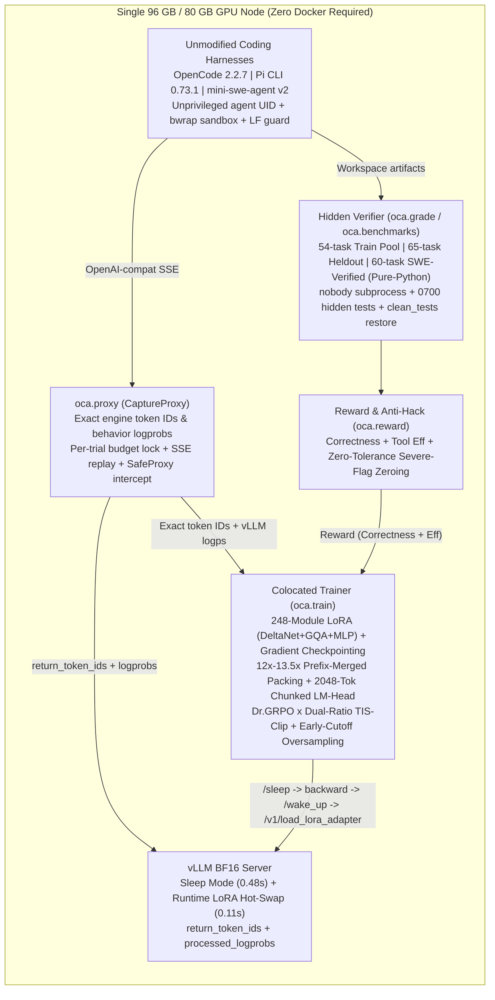

<div align="center">

# OpenCode & Pi Harness Adapter

**English** | [简体中文](README_ZH.md)

[](https://github.com/XDE10/opencode-harness-adapter/actions/workflows/ci.yml)
[](LICENSE)
[](https://huggingface.co/XDE10/Qwen3.5-9B-Harness-Adapters-v5)
[](pyproject.toml)

Single-GPU colocated Agentic Reinforcement Learning (**248-module LoRA `r=32`**) adapting `Qwen/Qwen3.5-9B` (non-thinking mode) to operate unmodified terminal coding harnesses (**OpenCode 2.2.7**, **Pi 0.73.1**, and zero-shot OOD **mini-swe-agent v2**).

[English Technical Report](docs/V5_REPORT_EN.md) · [中文完整技术报告](docs/V5_EXPLAINER_ZH.md) · [HuggingFace Weights](https://huggingface.co/XDE10/Qwen3.5-9B-Harness-Adapters-v5) · [Agent Guide (`AGENTS.md`)](AGENTS.md)

</div>

---

## Highlights

- **Single 96 GB GPU Colocated RL (Zero Docker Required)**: Replaces multi-GPU async clusters (e.g., 2×B200 + Docker/Harbor) with a self-contained single-GPU loop: **`0.48s` vLLM Sleep offload**, **`0.11s` runtime LoRA hot-swap**, **`12×–13.5×` Prefix-Merged Multi-Turn Packing**, **Exact Chunked LM-Head Backward** (`248K` vocab, `~40 GiB` peak training VRAM), and **Dual-Ratio `Dr.GRPO × TIS-Clip`** calibration.
- **11,220 Paired Evaluation Trials (0 Errored Trials, 0.0% `<think>` Leakage)**: Without cherry-picking per-suite winners, the recommended balanced adapter (`soup_v5_pi_qr_svd`) lifts the **5-suite mean from `33.12% → 44.27%` (`+11.15 pp`)**, outperforming Base on every suite and transferring **`+10.0 pp`** zero-shot to unseen `mini-swe-agent v2`.
- **Grounded Empirical Audit & Independent Official Docker Spot-Check**: Documents both positive gains and honest negative findings (equal-weight 0.5/0.5 cross-harness `super_*` merges trail Same-Harness Soup; near-zero weight cosine is a LoRA-A init-seed artifact), plus an independent **6-task (34 clean paired trials) official `SWE-bench_Verified` Docker audit** (**`28/28 = 100.0%`** exact agreement on `django` + `sympy` covering 96.7% of the subset; 1 genuine `p2p[:25]` false-positive task exposed on `psf__requests-5414`).
- **Portable & One-Click Runnable**: Zero hardcoded personal or Colab paths — all directories resolve dynamically via `OCA_HOME` (`oca/paths.py`), with ready-to-run scripts under `scripts/`.

---

## Visual Overview & 5-Suite Leaderboard

| Visual Explainer | Key Takeaway |
| --- | --- |
|  | **Single-GPU Colocated RL Loop**: 54-task multi-file pool (`SWE-smith-py` + L2 + L1), 248-module LoRA (DeltaNet + GQA + MLP), `0.48s` Sleep, `0.11s` LoRA hot-swap, `~40 GiB` peak training VRAM. |
|  | **5-Suite Leaderboard & Negative Super-Adapter Finding**: `soup_v5_pi_qr_svd` lifts the 5-suite mean **`33.12% → 44.27%`** (beating Base on all 5 suites and rescuing `v5_pi_seed2`'s `SWE-OC` drop from `32.5% → 40.0%`); **`+10.0–12.3 pp`** zero-shot on unseen `mini-swe-agent`. Equal-weight 0.5/0.5 cross-harness `super_*` (`40.76%–42.45%`) trail single-harness Pi (`43.55%`) and Same-Harness Soup (`44.27%`). |
|  | **4-Way Algorithm Ablation & GSPO Prefix-Shattering Observation**: On `pi_heldout` (single seed), `Dr.GRPO+TIS` (`47.31%`) > `CISPO` (`46.15%`, shortest tokens) > `Turn-Credit` (`45.77%`, fewest turns) > `GSPO` (`43.85%`, n.s.). Sequence-level `GSPO` slows backward passes **5–6× (`180s → 1,177s`, `29 → 238` segments)**, hypothesized to stem from redundant `</function></function>` tags canonicalized on the next turn. |
|  | **248-Module Weight ($\Delta W$) vs Activation ($\Delta h$) Analysis**: Near-zero weight cosine (`+0.0001`) is a **LoRA-A init-seed artifact** (same-harness diff-seed is also `+0.0001`, vs `+0.0180` same-seed cross-harness). Activation cosine over 16 prompts shows only a modest positive shift (`mean +0.0308`, median `+0.0155`, DeltaNet `+0.0456` > MLP `+0.0134`). |

### V5 5-Benchmark Master Table (`Pass@1`, Task-Level Permutation `p`, 0 Errored Trials)

| Adapter / Method (`Qwen3.5-9B`, 248-mod LoRA `r=32`) | **5-Suite Mean** | Pi Heldout *(65×4)* | OC Heldout *(65×4)* | OOD `mini-swe` *(65×2)* | SWE-Verified* Pi *(60×2)* | SWE-Verified* OC *(60×2)* |
| --- | :---: | :---: | :---: | :---: | :---: | :---: |
| `Base Qwen3.5-9B` (Non-Thinking) | `33.12%` | `36.92%` | `38.85%` | `32.31%` | `23.33%` | `34.17%` |
| `v5_pi_seed2` (Pi RL, seed 2) | **`45.22%`** | **`56.15%`** *(p=0.0001)* | **`51.15%`** *(p=0.0018)* | **`44.62%`** *(p=0.0018)* | `41.67%` *(p=0.0003)* | `32.50%` *(p=0.865)* |
| **`soup_v5_pi_qr_svd`** *(Recommended)* | **`44.27%`** | `47.69%` *(p=0.0022)* | `48.85%` *(p=0.0135)* | `42.31%` *(p=0.0387)* | `42.50%` *(p=0.0007)* | `40.00%` *(p=0.347)* |
| `v5_pi_drgrpo_tis` (Pi RL, seed 1) | `43.55%` | `47.31%` *(p=0.0049)* | `47.31%` *(p=0.0121)* | `42.31%` *(p=0.0049)* | `40.83%` *(p=0.0003)* | `40.00%` *(p=0.209)* |
| `soup_v5_pi_concat_2r` (Same-Harness 2r) | `43.05%` | `54.62%` *(p=0.0001)* | `45.77%` *(p=0.0945)* | `41.54%` *(p=0.0117)* | `40.00%` *(p=0.0009)* | `33.33%` *(p=1.000)* |
| `v5_joint_oc_pi` (50/50 Joint RL) | `42.67%` | `46.92%` *(p=0.0087)* | `43.85%` *(p=0.1645)* | `39.23%` *(p=0.0479)* | `38.33%` *(p=0.0057)* | `45.00%` *(p=0.0298)* |
| `super_v5_qr_svd` (Cross-Harness QR-SVD) | `42.45%` | `47.31%` *(p=0.0050)* | `47.69%` *(p=0.0054)* | `43.08%` *(p=0.0055)* | `35.83%` *(p=0.0353)* | `38.33%` *(p=0.494)* |
| `super_v5_concat_2r` (Cross-Harness 2r) | `42.33%` | `45.00%` *(p=0.0499)* | `47.31%` *(p=0.0062)* | `37.69%` *(p=0.0654)* | **`43.33%`** *(p=0.0002)* | `38.33%` *(p=0.471)* |
| `v5_oc_main` (OpenCode RL) | `42.06%` | `45.00%` *(p=0.0232)* | `46.15%` *(p=0.0621)* | `40.00%` *(p=0.0529)* | `33.33%` *(p=0.0781)* | **`45.83%`** *(p=0.0057)* |
| `super_v5_ties` (Cross-Harness TIES 0.5) | `40.76%` | `41.54%` *(p=0.0584)* | `45.38%` *(p=0.0196)* | `37.69%` *(p=0.2349)* | `37.50%` *(p=0.0042)* | `41.67%` *(p=0.144)* |
| `v5_rft_plus_rl` / `v5_rft_only` | — | `48.46%` / `38.08%` | `46.92%` / `39.62%` | `38.46%` / `33.85%` | `34.17%` / `26.67%` | — |
| `v5_pi_cispo` / `v5_pi_turn_credit` / `v5_pi_gspo` | — | `46.15%` / `45.77%` / `43.85%` | — | — | — | — |

*\*Zero-Docker `SWE-bench_Verified` 60-task subset covers `django` (36), `sympy` (22), and `requests` (2) in shared Python 3.11 venvs with `p2p[:25]` (`-k` capped at 30). Independent official Docker spot-check (6 cross-repo tasks, 34 clean paired trials): **`28/28 (100.0%)`** exact agreement on `django` + `sympy` (all `16/16` Colab-PASS confirmed `RESOLVED`, including `soup` `8/8` vs `base` `0/7` on 4 Base-failing tasks); `psf__requests-5414` (3.3% minor repo) exposed 1 genuine `p2p[:25]` regression false-positive task (3 trials, overall `31/34 = 91.2%`). See Section 7 of [docs/V5_REPORT_EN.md](docs/V5_REPORT_EN.md).*

---

## Architecture



---

## One-Click Quick Start

### 1. Local CPU Verification (Windows Git Bash / macOS / Linux)

```bash
git clone https://github.com/XDE10/opencode-harness-adapter.git
cd opencode-harness-adapter
pip install -e .

# Run all 28 unit tests + 10-attack adversarial anti-hack suite (~5s, no GPU needed)
bash scripts/verify.sh
```

### 2. Single-GPU Setup (Linux — 80 GB / 96 GB GPU)

Installs GPU dependencies, `opencode`, `pi`, `mini-swe-agent`, downloads `Qwen/Qwen3.5-9B`, and fetches the recommended pretrained `soup_v5_pi_qr_svd` adapter into `$OCA_HOME` (default `~/.cache/oca`):

```bash
bash scripts/setup_gpu.sh
```

### 3. One-Click Evaluation (Auto-Downloads Pretrained Adapter)

```bash
# Default: Pi CLI on 65-task heldout (Base vs soup_v5_pi_qr_svd) + trajectory audit
bash scripts/run_eval.sh

# Zero-shot OOD evaluation on unseen mini-swe-agent v2
HARNESS=mini_swe SPLIT=heldout SEEDS="101 102" bash scripts/run_eval.sh

# 60-task pure-Python SWE-bench_Verified subset (auto-rebuilds subset & exports predictions_*.jsonl for Docker)
HARNESS=pi SPLIT=swe_verified SEEDS="101 102" bash scripts/run_eval.sh
```

### 4. One-Click Single-GPU RL Training & CPU Adapter Merging

```bash
# Train 50-step 248-module LoRA RL on Pi (Dr.GRPO + Dual-Ratio TIS-Clip + Early-Cutoff)
bash scripts/run_train.sh

# Train a second seed and merge on CPU (~1s) into a balanced Same-Harness Soup
LORA_SEED=2027 bash scripts/run_train.sh
python -u -m oca.merge --method qr_svd \
  --adapter pi_s1=./runs/v5_pi_tis_clip_s2026/checkpoints/step_050:0.5 \
  --adapter pi_s2=./runs/v5_pi_tis_clip_s2027/checkpoints/step_050:0.5 \
  --out-dir ./runs/soup_v5_pi_qr_svd
```

### Environment Variables (`oca/paths.py`)

All runtime paths are portable and configurable via environment variables (no hardcoded `/content/` paths required):

| Variable | Default | Purpose |
| --- | --- | --- |
| `OCA_HOME` | `~/.cache/oca` | Root cache for models, CLI tools, SWE venvs/mirrors, and downloaded adapters |
| `OCA_MODEL_PATH` | `$OCA_HOME/models/qwen35-9b` *(or HF `Qwen/Qwen3.5-9B`)* | Base model directory or HuggingFace Hub ID |
| `OCA_TOOLS_DIR` | `$OCA_HOME/tools` | Prefix directory where `setup_gpu.sh` installs `opencode` and `pi` CLIs |
| `OCA_RUNS_DIR` | `./runs` | Default output directory for training/evaluation logs and checkpoints |
| `OCA_WORKDIR_ROOT` | `/dev/shm/oca_work` *(when ≥16 GiB free, else system temp)* | Fast scratch root for isolated per-trial workspaces |
| `OPENCODE_BIN` / `PI_BIN` / `MINI_SWE_BIN` | Auto-resolved via `PATH` or `$OCA_TOOLS_DIR` | Explicit harness CLI binary overrides |

---

## Repository Layout

```text
opencode-harness-adapter/
├── README.md                   # English documentation (you are here)
├── README_ZH.md                # Simplified Chinese documentation
├── AGENTS.md                   # Machine-readable guide for AI coding agents
├── LICENSE / NOTICE            # Apache-2.0 license & attribution notice
├── pyproject.toml              # Package metadata & CPU / GPU extras
├── scripts/
│   ├── verify.sh               # One-click local CPU unit tests + 10-attack anti-hack check
│   ├── setup_gpu.sh            # One-click Linux GPU provisioning (vLLM, CLIs, weights, adapter)
│   ├── run_eval.sh             # One-click paired evaluation + trajectory audit
│   └── run_train.sh            # One-click 50-step single-GPU colocated RL run
├── oca/
│   ├── paths.py                # Portable env-driven path & binary resolver (zero hardcoding)
│   ├── harnesses/              # Pluggable CLI adapters: opencode.py, pi.py, mini_swe.py
│   ├── benchmarks/             # Zero-Docker swe_verified.py & swe_smith_train.py builders
│   ├── verl_bridge/            # veRL AgentLoop bridge & GRPO YAML config
│   ├── proxy.py                # CaptureProxy (engine token IDs, logprobs, SSE replay, SafeProxy)
│   ├── rollout.py              # Isolated trial runner (bwrap, agent UID, LF guard, unified diff export)
│   ├── grade.py                # Unprivileged nobody hidden grader (single_file + repo_pytest + rlimits)
│   ├── reward.py               # Correctness + joint turn/token efficiency + anti-hack zeroing
│   ├── train.py                # Colocated V5 RL/RFT (Sleep/HotSwap, Prefix-Merge, Chunked LM-Head)
│   ├── eval.py                 # Cluster bootstrap CI, permutation test, Holm-Bonferroni & predictions.jsonl
│   ├── merge.py                # CPU QR-SVD / Concat-2r / TIES merging + weight/activation cosine
│   ├── audit_trajectories.py   # Error-recovery rate, tool-share & thinking-leakage auditor
│   ├── adversarial.py          # 10-exploit reward-hacking regression suite
│   ├── tasks.py / validate.py / clean_data.py / gen_tasks.py / gen_repo_tasks.py / build_ood_oss.py
│   └── plots.py / profile_step.py
├── protocol/                   # Frozen V5 config (oca-v5.json), 54-task pool, 60-task SWE manifest & L1 manifest
├── data/ & tasks/ & grader/    # Cleaned L1 single-file, L2 repo_pytest & L3 OSS OOD suites
├── docs/                       # V5_REPORT_EN.md, V5_EXPLAINER_ZH.md & 4 editorial visual figures
└── tests/                      # 28 local CPU unit tests (test_oca_v4.py + test_oca_v5.py)
```

---

## Historical V4 Controlled Ablations

<details>
<summary>Expand V4 Controlled Ablations (128-module LoRA, OpenCode 2.2.7, 65 Heldout × 4 Seeds, fixed 10,240-token trial budget)</summary>

These earlier V4 single-seed controls on `Qwen/Qwen3.5-9B` (128-module GQA+MLP LoRA, fixed `max_output_tokens_per_trial=10240`, `max_model_calls=24`) motivated three V5 design choices:

| Historical V4 Arm (OpenCode 2.2.7, 260 trials each) | Overall `pass@1` (`Δ`) | `pass@4` | Mean Tokens | Common-Solved Eff (Tok / Tool) | Perm `p` |
| --- | --- | --- | --- | --- | --- |
| `Base-Off` (`enable_thinking=False`) | `40.77%` (—) | `63.08%` | `5,003` | — | — |
| `Base Thinking-ON` (`enable_thinking=True`) | `40.77%` (`+0.00 pp`) | `56.92%` | **`9,298` (+85.9%)** | `-92.3%` tok bloat / `+20.3%` tool | `1.0000` |
| **Ablation A: Naive `PPO-Clip`** (40 steps, no TIS) | `40.00%` (`-0.77 pp`) | `60.00%` | `4,760` | `+17.1%` tok / `+28.3%` tool | `0.9087` |
| **Ablation B: `Binary Only`** (40 steps, `eff_w=0.0`) | `46.92%` (`+6.15 pp`) | `63.08%` | `5,266` | `-6.5%` tok bloat / `+11.7%` tool | `0.0590` |

*Notes*: Under the fixed `10,240`-token budget, enabling thinking nearly doubled output tokens (`5,003 → 9,298`) for `+0.00 pp` `pass@1` and `-6.16 pp` `pass@4` due to budget truncation (motivating V5 non-thinking mode; adaptive thinking under larger budgets remains future work). Removing engine-trainer TIS degraded L1 accuracy (`-6.95 pp`, overall `-0.77 pp`), motivating Dual-Ratio `Dr.GRPO × TIS-Clip`. Removing `eff_w` increased common-solved token usage (`+6.5%`), motivating light efficiency shaping (`eff_w=0.05`).

</details>

---

## License

Apache-2.0 — see [LICENSE](LICENSE) and [NOTICE](NOTICE).
