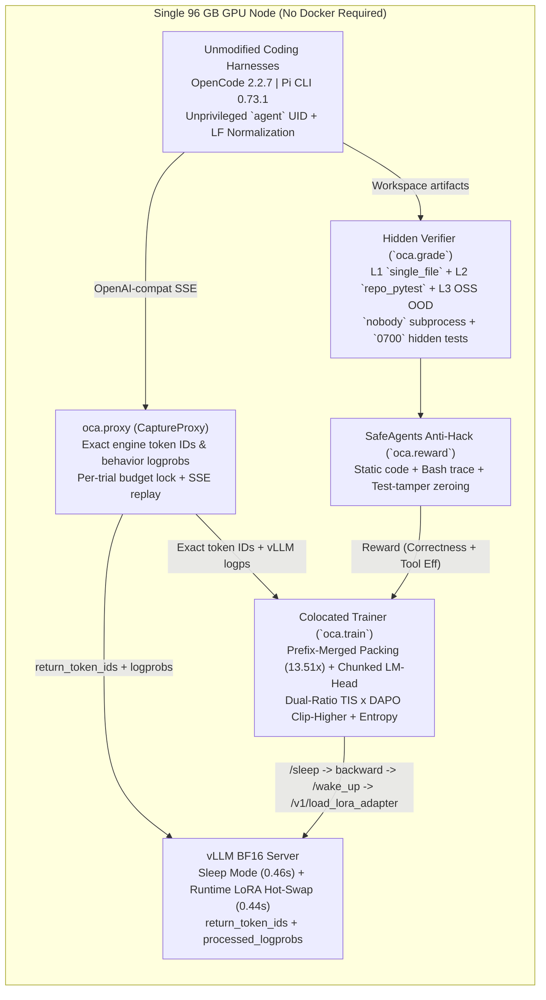
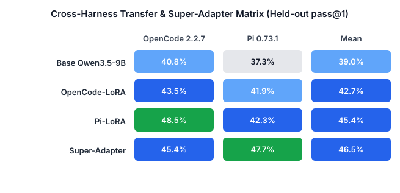
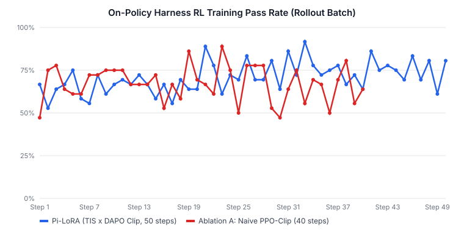
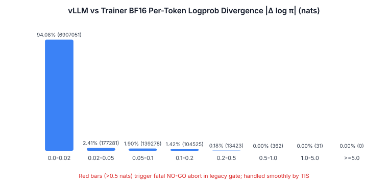
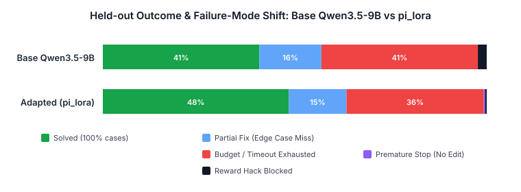

# OpenCode & Pi Harness Adapter

Single-GPU colocated Agentic Reinforcement Learning (**LoRA GRPO**) that adapts a lightweight open-weight model (`Qwen/Qwen3.5-9B`, non-thinking mode) to operate unmodified terminal coding harnesses (**OpenCode 2.2.7** & **Pi 0.73.1**) — and merges harness-specific adapters via exact **Rank-2r QR-SVD** into a single **Super-Adapter** achieving **`+10.38 pp` (`p = 0.0020`, `pass@4 = 70.77%`)** on Pi and **`+7.50 pp` cross-harness mean** across 65 strictly held-out tasks (L1 single-file + L2 multi-file `repo_pytest` + L3 real OSS OOD bugfix commits).

Inspired by Hugging Face's *Harness Adapters* (Nov 2026), this repository replaces multi-GPU asynchronous clusters (e.g., 2×B200 + Docker/Harbor) with a self-contained **single 96 GB GPU** (RTX PRO 6000 Blackwell on Colab G4) loop featuring **0.46s vLLM Sleep offload**, **0.44s runtime LoRA hot-swap**, **13.51× Prefix-Merged Multi-Turn Packing**, **Exact Chunked LM-Head Backward** (for 248K vocab), and **Dual-Ratio `TIS × DAPO Clip-Higher`** engine-mismatch calibration.

---

## Architecture



---

## Main Experimental Results (`Qwen/Qwen3.5-9B`, 65 Heldout × 4 Seeds = 2,860 Trials)

All evaluations run on **65 strictly unseen tasks × 4 seeds (260 trials per cell)** spanning three difficulty tiers with **zero domain overlap** against the 98-task training set:
- **L1 Single-File (`36 tasks`)**: Domain-disjoint Python state-machine & algorithmic debugging suite.
- **L2 Multi-File `repo_pytest` (`12 tasks`)**: 3–4 module repositories across 5 unseen engineering domains with cross-module bugs and hidden `pytest` suites.
- **L3 Real OSS OOD (`17 tasks`)**: Real historical bugfix commits mined from `pypa/packaging`, `pallets/click`, and `more-itertools`, verified against up to 7,923 upstream `pytest` regression tests.

### 1. 2×2 Cross-Harness Transfer & Super-Adapter Matrix (`pass@1` / `pass@4`)



| Model (`Qwen/Qwen3.5-9B`, LoRA `r=32`) | OpenCode 2.2.7 (`Δ`, `p`) | Pi 0.73.1 (`Δ`, `p`) | **Cross-Harness Mean** | OpenCode L2 Repo (12) | Pi L2 Repo (12) |
| --- | --- | --- | --- | --- | --- |
| `Base Qwen3.5-9B` (Non-Thinking) | 40.77% (`p@4` 63.1%) | 37.31% (`p@4` 58.5%) | **39.04%** | 18.75% | 22.92% |
| `OpenCode-LoRA` (50 steps, `TIS×Clip`) | 43.46% (`+2.69 pp`, `0.450`) | 41.92% (`+4.62 pp`, `0.196`) | **42.69%** (`+3.65 pp`) | 29.17% (`+10.4`) | 35.42% (`+12.5`) |
| `Pi-LoRA` (50 steps, `TIS×Clip`) | **48.46%** (**`+7.69 pp`**, **`p=0.0375`**) | 42.31% (`+5.00 pp`, `0.168`) | **45.39%** (`+6.35 pp`) | **31.25%** (`+12.5`) | 20.83% (`-2.1`) |
| **🏆 `Super-Adapter` (Exact QR-SVD 0.5/0.5)** | **45.38%** (`+4.62 pp`, `p@4` 64.1%) | **47.69%** (**`+10.38 pp`**, **`p=0.0020`**, `p@4` **70.8%**) | **🏆 46.54% (`+7.50 pp`)** | 27.08% (`+8.3`) | **45.83% (`+22.9`, 2.0×!)** |

**Key Findings:**
1. **`1 + 1 > 2` Emergent Super-Adapter Synergy (`p = 0.0020`)**: On Pi, our exact Rank-2r QR-SVD Super-Adapter (`47.69%`, 95% CI `[+4.23, +16.54 pp]`, 46 wins vs 19 losses, `pass@4 = 70.77%`) outperforms **both** single-harness parents across every tier — doubling Base L2 multi-file repo accuracy (`22.92% → 45.83%`) while lifting L1 single-file (`54.86% → 65.97%`).
2. **Mechanistic Explanation — Orthogonal LoRA Subspaces**: Exact Frobenius inner-product analysis (`oca/merge.py --method qr_svd`, `0.94s` on CPU across 128 LoRA modules) reveals near-exact orthogonality between OpenCode-trained and Pi-trained weight updates (`mean_dw_cosine = 0.0000`, range `[-0.0010, +0.0013]`, `||ΔW_pi|| = 0.1184`, `||ΔW_oc|| = 0.1138`), allowing rank-32 SVD superposition (78.2% energy retained) with zero destructive interference.
3. **Minimalist Harness → Cleaner Credit Assignment**: Training in the minimalist 4-tool **Pi CLI** (`12.64×` prefix compression, minimal context rewrites) transfers zero-shot to the heavier **OpenCode 2.2.7** harness at **`48.46%` (`+7.69 pp`, `p = 0.0375`)**, cutting common-solved tool calls by **`-26.6%`** and tokens by **`-18.3%`**.

---

### 2. Controlled Ablations & Thinking-Mode Comparison (OpenCode Harness, 65 Heldout × 4 Seeds)

| Arm (OpenCode 2.2.7, 260 trials each) | Overall `pass@1` (`Δ`) | `pass@4` | L1 (36) | L2 Repo (12) | L3 OOD (17) | Mean Tokens | Common-Solved Eff (Tok / Tool) | Perm `p` |
| --- | --- | --- | --- | --- | --- | --- | --- | --- |
| `Base-Off` (`enable_thinking=False`) | 40.77% (—) | 63.08% | 63.89% | 18.75% | 7.35% | 5,003 | — | — |
| `Base Thinking-ON` (`enable_thinking=True`) | 40.77% (`+0.00 pp`) | 56.92% | 61.81% | 18.75% | 11.76% | **9,298 (+85.9%)** | **-92.3% tok bloat** / +20.3% tool | 1.0000 |
| **Ablation A: Naive `PPO-Clip`** (40 steps, no TIS) | **40.00%** (`-0.77 pp`) | 60.00% | 56.94% | 25.00% | **14.71%** | 4,760 | +17.1% tok / +28.3% tool | 0.9087 |
| **Ablation B: `Binary Only`** (40 steps, `eff_w=0.0`) | 46.92% (`+6.15 pp`) | 63.08% | 70.14% | **31.25%** | 8.82% | 5,266 | **-6.5% tok bloat** / +11.7% tool | 0.0590 |
| **`OpenCode-LoRA`** (50 steps, `TIS×Clip`, `eff_w=0.1`) | 43.46% (`+2.69 pp`) | 58.46% | 63.19% | 29.17% | 11.76% | 5,742 | -15.1% tok / +14.8% tool | 0.4497 |
| **`Super-Adapter`** (QR-SVD 0.5/0.5) | 45.38% (`+4.62 pp`) | 64.06% | 68.06% | 27.08% | 10.29% | 5,316 | **+5.9% tok / +18.5% tool** | 0.1447 |
| **`Pi-LoRA`** (50 steps, `TIS×Clip`, `eff_w=0.1`) | **48.46% (`+7.69 pp`)** | **66.15%** | **72.22%** | **31.25%** | 10.29% | 5,170 | **+18.3% tok / +26.6% tool** | **0.0375** |

*Positive efficiency percentages (`+18.3% tok`) indicate token/tool reductions on paired commonly solved trials; negative percentages indicate bloat.*

- **Why Harness RL Beats Thinking Mode**: Enabling `Qwen3.5-9B` Thinking nearly doubles token consumption (`5,003 → 9,298`) for **+0.00 pp** net accuracy gain and **-6.16 pp lower `pass@4`** due to multi-turn budget exhaustion, whereas non-thinking Harness RL boosts accuracy by up to **`+7.69 pp`** (OpenCode) / **`+10.38 pp`** (Pi) at ~half the tokens.
- **Why Dual-Ratio `TIS × DAPO Clip-Higher` Matters (Ablation A)**: BF16 vLLM↔PyTorch logprob tails regularly hit `0.8–4.8 nats` during 50-step runs; Naive `PPO-Clip` degrades L1 accuracy by `-6.95 pp` (overall `-0.77 pp`, `p=0.909`), whereas `TIS × Clip` stays stable across all 180 RL steps.
- **Why Tool-Efficiency Reward Matters (Ablation B)**: Removing the turn-efficiency bonus (`eff_w=0.0`) still lifts accuracy (`+6.15 pp`) but causes common-solved trajectories to **bloat `+6.5%` in tokens**, vs **`-18.3%` token cut & `-26.6%` tool-call cut** with `eff_w=0.1` (**24.8 pp efficiency swing**).

---

## Training Telemetry & Diagnostics





| Engineering / Systems Milestone | Measured Telemetry (Colab G4 RTX PRO 6000 Blackwell 96 GB) |
| --- | --- |
| **3-Model Live Base Bake-Off** (12 tasks × 2 seeds, LF-fixed) | `Qwen3-8B`: 8.3% (L2 `0.0%`) → `Qwen3-14B`: 4.2% (L2 `0.0%`) → **`Qwen3.5-9B`: 41.7%** (L2 **`41.7%`**, `p@2=50.0%`) |
| **98-Task × 4-Seed Screening Funnel** (`protocol/screen_qwen35_9b.json`) | Base `pass@1` **46.94%**; **45/98 (45.9%) informative (`1..3/4`)** tasks (33 L1 + 12 L2 repos) — **7.5×** denser GRPO signal than `Qwen3-8B` |
| **Single-Card Colocation Overhead** | vLLM `sleep(level=1)` **0.46s** (`74.7 → 20.0 GiB`), `/wake_up` + LoRA hot-swap **0.90s** (`lora_swap_only=0.44s`), zero vLLM restarts across 50 steps |
| **Prefix-Merged Multi-Turn Packing** (`Qwen3.5-9B` + FLA) | **13.51× wall-clock speedup** (`304.1s → 22.5s`, 8.38×–12.64× segment compression, gradient cosine `0.989`), auto-splitting on context compaction |
| **Exact Chunked LM-Head Backward** (248K vocab) | `max_lp_diff = 0.000e+00`; 24,576-seq / 10,240-target stress pass in **21.75s** at **38.08 GB** peak VRAM (vs >100 GB OOM unchunked); live step peak **34–41 GB** |
| **Exact Rank-2r QR-SVD Super-Adapter Merge** | Merges 128 rank-32 LoRA modules in **0.94s on CPU** (0 GPU VRAM, no 9B base model needed), **78.2%** SVD energy retained |
| **Anti-Reward-Hacking Suite** (`oca/adversarial.py`, `oca/reward.py`) | **10/10** adversarial exploits blocked in CI + live Step-1 audit eliminated false positives on Python `nc` and `pytest ../../tests/test_smoke.py` |
| **Local Unit Test Suite** (`tests/test_oca_v4.py`) | **11/11 passing** (domain isolation, `repo_pytest` triple-control, prefix-merge compaction split, dual harness, proxy capture, 10/10 anti-hack, permutation tests, SVG plots) |

---

## Quick Start

### 1. Clone & 30-Second Local CPU Verification (Win11 / macOS / Linux)

```bash
git clone https://github.com/XDE10/opencode-harness-adapter.git
cd opencode-harness-adapter
pip install -e .

# Verify all 11 unit tests (L1/L2/L3 dataset isolation, prefix-merge packing, proxy, 10/10 anti-hack, SVG plots)
python -m unittest discover -s tests -v
python -m oca.adversarial
```

### 2. Single-GPU Reproduction (Linux / Colab G4 96 GB)

```bash
pip install -e ".[gpu]"

# 1) Provision vLLM, FLA, OpenCode 2.2.7, Pi CLI 0.73.1 & Qwen/Qwen3.5-9B weights
python -m oca.colab.probe_env

# 2) (Optional) Re-run 4-seed difficulty screening (frozen summary already in protocol/screen_qwen35_9b.json)
python -m oca.train --mode screen --harness opencode --out-dir /content/runs/screen_oc --k 4 --concurrency 32

# 3) 50-step colocated LoRA GRPO (rank 32, Prefix-Merged, Chunked LM-Head, Dual-Ratio TIS x Clip)
python -m oca.train --mode train --harness opencode --out-dir /content/runs/oc_main \
  --task-ids-file protocol/screen_qwen35_9b.json --steps 50 --concurrency 32

# 4) Train Pi adapter & merge via exact Rank-2r QR-SVD into a single Super-Adapter (~1s CPU)
python -m oca.train --mode train --harness pi --out-dir /content/runs/pi_main \
  --task-ids-file protocol/screen_qwen35_9b.json --steps 50 --concurrency 32
python -m oca.merge --method qr_svd \
  --adapter opencode=/content/runs/oc_main/checkpoints/step_050:0.5 \
  --adapter pi=/content/runs/pi_main/checkpoints/step_050:0.5 \
  --out-dir /content/runs/super_adapter_svd

# 5) Multi-seed paired evaluation & SVG plots
python -m oca.eval --harness pi --split heldout --out-dir /content/runs/eval_pi \
  --lora super=/content/runs/super_adapter_svd
python -m oca.plots --history /content/runs/pi_main/history.jsonl \
  --eval-report /content/runs/eval_pi/eval_report.json --out-dir docs/figures
```

---

## Repository Layout

```text
opencode-harness-adapter/
├── oca/
│   ├── harnesses/        # Pluggable OpenCode 2.2.7 & Pi 0.73.1 CLI adapters
│   ├── colab/            # G4 probe, Phase 0/1 diagnostic, job runner & LF tarball packer
│   ├── proxy.py          # Engine-boundary CaptureProxy (token IDs + processed logprobs + SSE)
│   ├── rollout.py        # Isolated trial runner (single_file + repo_pytest + LF guard)
│   ├── grade.py          # Unprivileged hidden grader (single_file + pytest multi-file)
│   ├── reward.py         # Correctness + tool efficiency + static/bash anti-hack zeroing
│   ├── train.py          # Colocated GRPO (Sleep/HotSwap + Prefix-Merged + Chunked LM-Head + TIS x Clip)
│   ├── eval.py           # Cluster Bootstrap CI, task-level permutation test & failure taxonomy
│   ├── merge.py          # Exact Rank-2r QR-SVD & PEFT TIES/DARE-TIES Super-Adapter merger
│   ├── plots.py          # Zero-dependency SVG charts & BF16/GGUF merge helper
│   ├── clean_data.py     # Validation, AST/slug dedup & strict domain-disjoint splitter
│   ├── gen_repo_tasks.py # Multi-file repo_pytest generator with automated pytest triple-control
│   ├── build_ood_oss.py  # Real pure-Python OSS historical bugfix OOD benchmark miner
│   └── adversarial.py    # 10-exploit reward-hacking regression suite
├── protocol/             # Experiment config (oca-v4.json), frozen screening & final results JSON
├── data/                 # Cleaned L1 single-file, L2 repo_pytest, L3 OSS OOD benchmarks (166 tasks)
├── docs/figures/         # Publication-grade SVG plots (transfer matrix, curves, divergence, taxonomy)
└── tests/                # Fast local unit test suite (11/11 passing)
```

## License

Apache-2.0 — see [LICENSES/Apache-2.0.txt](LICENSES/Apache-2.0.txt) and [NOTICE](NOTICE).
