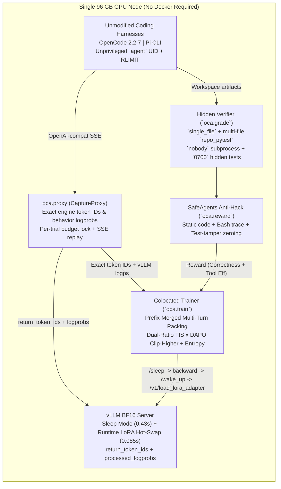

# OpenCode & Pi Harness Adapter

Single-GPU colocated Agentic Reinforcement Learning (**LoRA GRPO**) that adapts lightweight open-weight models (`Qwen/Qwen3-8B`, non-thinking mode) to operate unmodified terminal coding harnesses (**OpenCode 2.2.7** & **Pi**), inspired by Hugging Face's *Harness Adapters* (Nov 2026).

Instead of requiring multi-GPU asynchronous clusters (e.g., 2×B200), this framework runs the complete **Rollout → Engine Token/Logprob Capture → Hidden Test Verification → Prefix-Merged LoRA Update → Runtime Hot-Swap** loop on a **single 96 GB GPU** (RTX PRO 6000 Blackwell on Colab G4), with zero Docker daemon dependency and zero vLLM restarts.

---

## Architecture



---

## Key Engineering & Research Highlights

1. **Single-Card Colocation Without Restarts (`oca/train.py`)**
   - Uses vLLM `sleep(level=1)` (**0.43s** offload to host RAM: 70.6 GB → 18.3 GB) alternating with PEFT LoRA backward passes, followed by `/wake_up` + `/v1/load_lora_adapter` (**0.085s** LoRA swap) — verified on Colab G4 RTX PRO 6000 Blackwell.
2. **Prefix-Merged Multi-Turn Trajectory Packing (`oca/train.py:pack_trajectory_segments`)**
   - Collapses monotonic multi-turn agent histories into single causal forward passes with exact `loss_mask` (zero on prompt & tool outputs), eliminating $O(T^2)$ redundant prefix prefill while automatically splitting segments whenever context compaction/rewriting breaks prefix continuity.
3. **Engine-Trainer Divergence Calibration: Dual-Ratio `TIS × DAPO Clip-Higher`**
   - Empirical G4 telemetry revealed BF16 vLLM↔PyTorch logprob tails up to **0.891 nats** (7/5,216 tokens > 0.5 nats on Step 1 alone), breaking naive hard-abort gates.
   - Replaces brittle thresholds with detached **Truncated Importance Sampling (`tis_cap=2.0`, MIS outlier mask `<=5.0`)** for engine mismatch combined with **DAPO Clip-Higher (`0.20 / 0.28`)** across `minibatches=2` plus zero-cost **Policy Entropy** monitoring.
4. **Three-Tier Verifiable Coding Environments (`data/`)**
   - **L1 (Cleaned Single-File)**: Domain-disjoint deduplicated Python state-machine & algorithmic debugging suite (**71 train / 36 heldout**, 0 domain overlap; full funnel in `data/clean_report.json`).
   - **L2 (Mini-Repo2RLEnvs `repo_pytest`)**: Multi-file 3–4 module Python repositories (`src/<pkg>/...` + visible `tests/test_smoke.py` + hidden `tests_hidden/test_hidden.py`) with cross-module bugs, triple-control validated via `pytest` (**27 train / 12 heldout** across 14 strictly disjoint engineering domains in `data/repo_v1/`).
   - **L3 (Real OSS OOD Heldout)**: **17** out-of-distribution historical bugfix commits mined directly from pure-Python open-source repositories (`pypa/packaging`, `pallets/click`, `more-itertools`), verified against up to 7,923 real `pytest` regression tests (`data/ood_oss/`).
5. **Dual-Layer Reward-Hacking Defense (`oca/reward.py`, `oca/adversarial.py`)**
   - Combines OS privilege isolation (`agent` UID, `0700` hidden graders, `nobody` + `RLIMIT` workers) with static code inspection, **Bash command trace auditing**, and visible test tamper detection — **10/10** adversarial exploits blocked in CI.
6. **Multi-Harness Super-Adapter (`oca/harnesses/`, `oca/merge.py`)**
   - Pluggable support for **OpenCode 2.2.7** and **Pi** (`@earendil-works/pi-coding-agent`) over the exact same `CaptureProxy`, plus `linear` / `ties` / `dare_ties` LoRA merging into a single vLLM-loadable Super-Adapter.
7. **Cluster-Aware Statistical Evaluation (`oca/eval.py`)**
   - Multi-seed paired evaluation reporting `pass@1`, unbiased `pass@k`, **task-level Cluster Bootstrap 95% CI**, **task-level two-sided Paired Permutation Test** (avoiding within-task multi-seed independence violations), `common_solved` token/tool efficiency reductions, and automated failure-mode taxonomy.

---

## Verified Local & Smoke Telemetry

| Check / Milestone | Status | Measured Result |
| --- | --- | --- |
| Local Unit Test & Adversarial CI (`tests/test_oca_v4.py`) | Passing | **11/11 tests** (incl. 10/10 anti-hack blocks, `repo_pytest` triple-control, prefix-merge packing & compaction split) |
| Colab G4 Hardware Probe (`artifacts/smoke_g4/probe_report.json`) | Verified | RTX PRO 6000 Blackwell 97.9 GB, 48 vCPU, 176 GB RAM; Sleep/Wake roundtrip **2.37s** |
| Single-Card Colocated Step 1 (`artifacts/smoke_g4/step_001_metrics.json`) | Verified | Sleep **0.43s**, LoRA hot-swap **0.085s**, peak train VRAM **24.3 GB**, max `\|Δlogp\|` **0.891 nats** (handled smoothly by TIS) |
| Full Training & Super-Adapter Evaluation (60-step OpenCode + Pi) | In Progress | *Metrics table to be populated upon completion of G4 runs* |

---

## Quick Start

### 1. Local CPU Verification (Win11 / WSL2 / Linux)

```bash
python -m unittest tests/test_oca_v4.py -v
python -m oca.adversarial
python -m oca.colab.pack_repo   # builds artifacts/oca_repo.tar.gz (~350 KiB)
```

### 2. Colab G4 Single-GPU Workflow

```bash
# 1) Provision environment (vLLM, PEFT, pytest, OpenCode 2.2.7, Pi CLI, Qwen3-8B weights)
python -m oca.colab.probe_env

# 2) Phase 0/1: Failure diagnosis, Base Thinking-ON upper bound, Pi smoke & Prefix-Merge speedup benchmark
python -m oca.colab.phase0_1_diag --out-dir /content/runs/phase0_1_diag

# 3) 4-seed difficulty screening (filter 1..3/4 informative tasks for curriculum)
python -m oca.train --mode screen --harness opencode --out-dir /content/runs/screen_oc --k 4 --concurrency 32

# 4) 60-step colocated LoRA GRPO (rank 32, Prefix-Merged, Dual-Ratio TIS x Clip)
python -m oca.train --mode train --harness opencode --out-dir /content/runs/oc_main \
  --task-ids-file /content/runs/screen_oc/screen_summary.json --steps 60 --concurrency 32

# 5) Train Pi adapter & merge into a single Super-Adapter
python -m oca.train --mode train --harness pi --out-dir /content/runs/pi_main \
  --task-ids-file /content/runs/screen_oc/screen_summary.json --steps 60 --concurrency 32
python -m oca.merge --method ties --density 0.5 \
  --adapter opencode=/content/runs/oc_main/checkpoints/step_060:0.5 \
  --adapter pi=/content/runs/pi_main/checkpoints/step_060:0.5 \
  --out-dir /content/runs/super_adapter_ties

# 6) Multi-seed paired evaluation & SVG plots
python -m oca.eval --harness opencode --split heldout --out-dir /content/runs/eval_oc \
  --lora opencode=/content/runs/oc_main/checkpoints/step_060 \
  --lora super=/content/runs/super_adapter_ties
python -m oca.plots --history /content/runs/oc_main/history.jsonl \
  --eval-report /content/runs/eval_oc/eval_report.json --out-dir docs/figures
```

---

## Repository Layout

```text
opencode-harness-adapter/
├── oca/
│   ├── harnesses/        # Pluggable OpenCode 2.2.7 & Pi CLI adapters
│   ├── colab/            # G4 probe, Phase 0/1 diagnostic, job runner & tarball packer
│   ├── proxy.py          # Engine-boundary CaptureProxy (token IDs + processed logprobs + SSE)
│   ├── rollout.py        # Isolated trial runner (single_file + repo_pytest + RLIMIT)
│   ├── grade.py          # Unprivileged hidden grader (single_file + pytest multi-file)
│   ├── reward.py         # Correctness + tool efficiency + static/bash anti-hack zeroing
│   ├── train.py          # Colocated GRPO (Sleep/HotSwap + Prefix-Merged Packing + TIS x Clip)
│   ├── eval.py           # Cluster Bootstrap CI, task-level permutation test & failure taxonomy
│   ├── merge.py          # TIES / DARE-TIES / Linear Super-Adapter merger
│   ├── plots.py          # Zero-dependency SVG charts & GGUF weight merge helper
│   ├── clean_data.py     # Validation, AST/slug dedup & strict domain-disjoint splitter
│   ├── gen_repo_tasks.py # Multi-file repo_pytest generator with automated pytest triple-control
│   ├── build_ood_oss.py  # Real pure-Python OSS historical bugfix OOD benchmark miner
│   └── adversarial.py    # 10-exploit reward-hacking regression suite
├── protocol/             # Experiment config (oca-v4.json) & frozen v3 manifest
├── data/                 # Cleaned L1 single-file, L2 repo_pytest, L3 OSS OOD benchmarks
└── tests/                # Fast local unit test suite
```

## License

Apache-2.0 — see [LICENSES/Apache-2.0.txt](LICENSES/Apache-2.0.txt) and [NOTICE](NOTICE).
