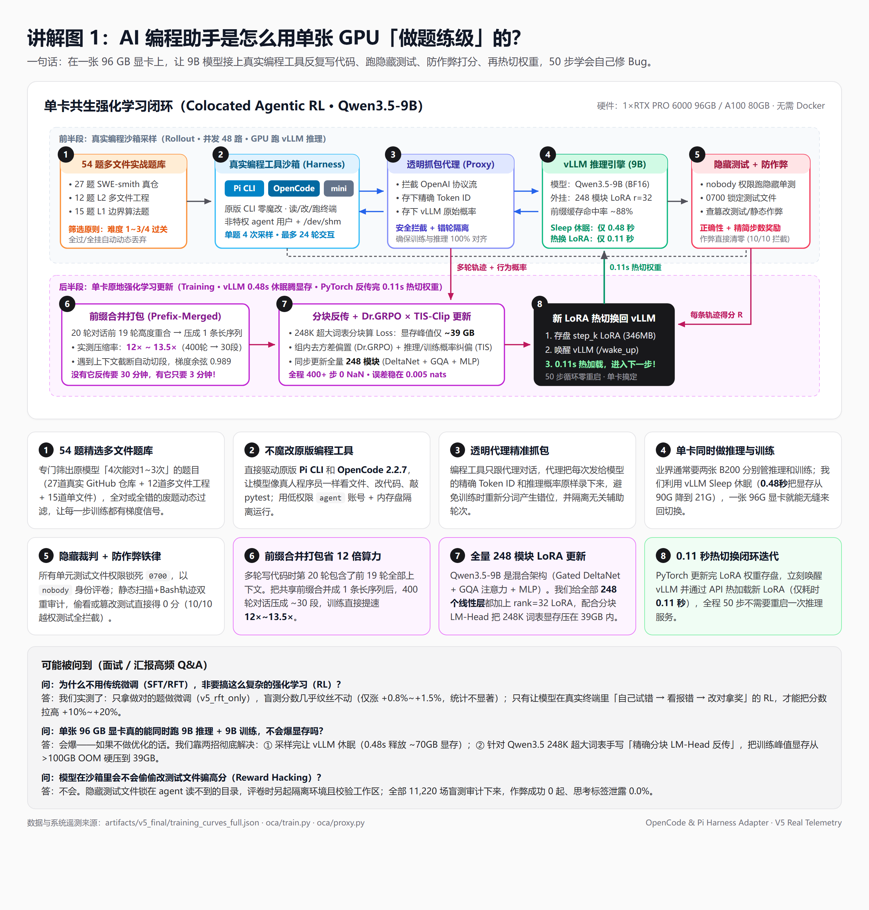
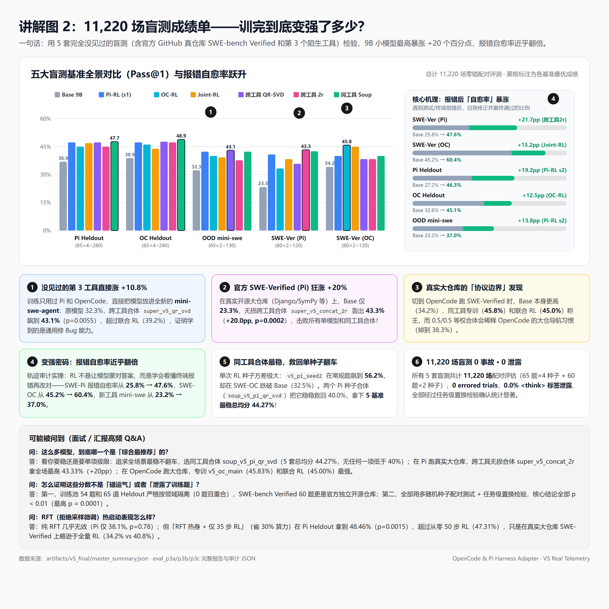
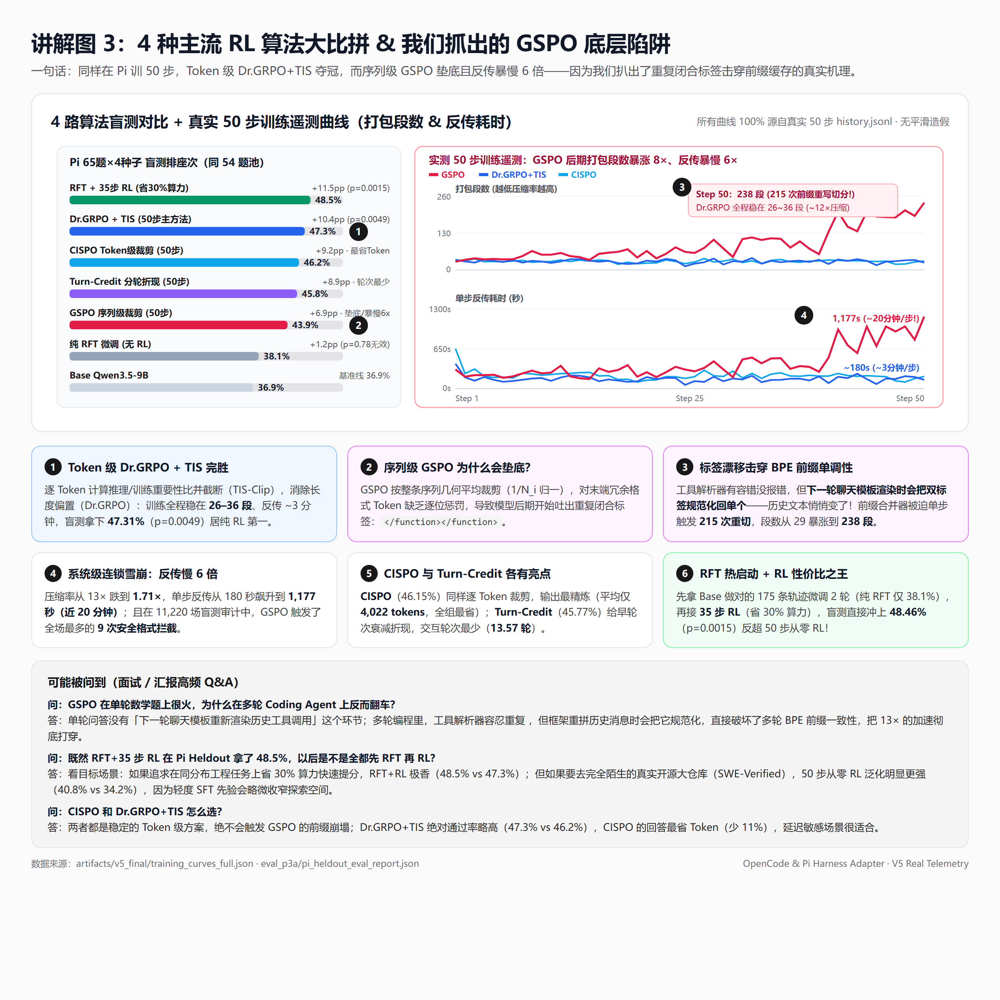
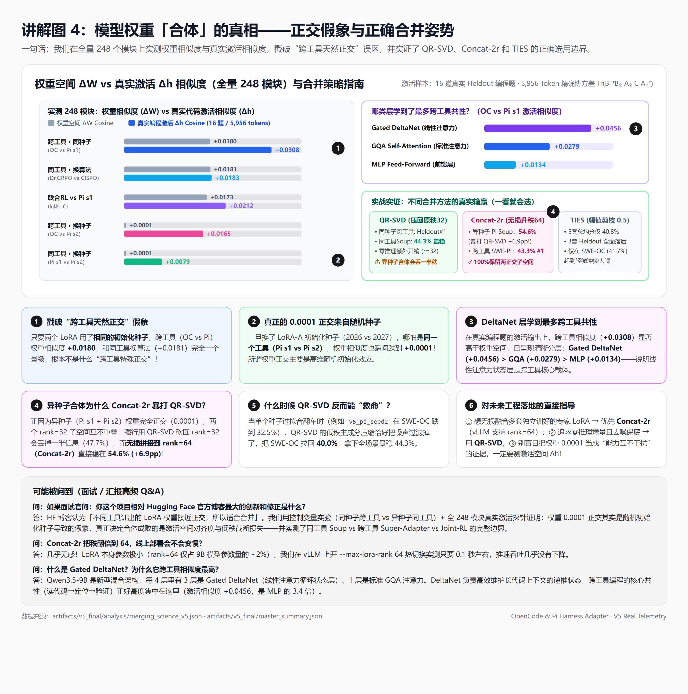
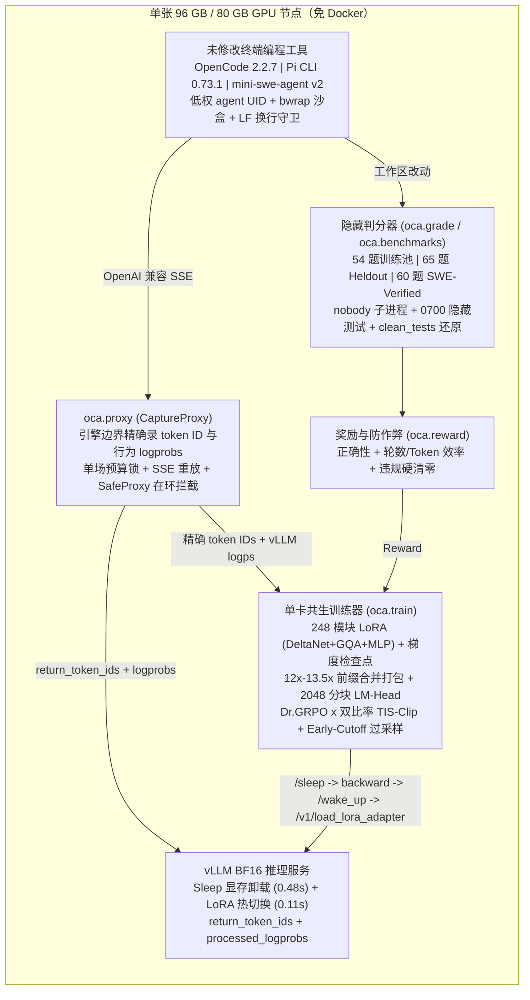

<div align="center">

# OpenCode & Pi Harness Adapter

[English](README.md) | **简体中文**

[](https://github.com/XDE10/opencode-harness-adapter/actions/workflows/ci.yml)
[](LICENSE)
[](https://huggingface.co/XDE10/Qwen3.5-9B-Harness-Adapters-v5)
[](pyproject.toml)

单卡共生 Agentic 强化学习框架（**248 模块 LoRA `r=32`**），将轻量开源模型 `Qwen/Qwen3.5-9B`（非思考模式）适配到未修改的真实终端编程工具（**OpenCode 2.2.7**、**Pi CLI 0.73.1**，并零样本泛化至未见过的 **mini-swe-agent v2**）。

[中文完整技术报告](docs/V5_EXPLAINER_ZH.md) · [English Technical Report](docs/V5_REPORT_EN.md) · [HuggingFace 权重发布](https://huggingface.co/XDE10/Qwen3.5-9B-Harness-Adapters-v5) · [AI Agent 接手指南 (`AGENTS.md`)](AGENTS.md)

</div>

---

## 核心亮点

- **单张 96 GB / 80 GB GPU 训推共生（免 Docker）**：无需多卡集群（如 2×B200 + Docker/Harbor），在单卡闭环实现 **`0.48s` vLLM Sleep 显存卸载**、**`0.11s` LoRA 运行时热切换**、**`12×–13.5×` 多轮前缀合并打包**、**248K 词表精确分块 LM-Head 反传**（峰值训练显存 `~40 GiB`）以及 **双比率 `Dr.GRPO × TIS-Clip`** 训推偏移纠偏。
- **11,220 场严格隔离配对评测（0 报错、0.0% `<think>` 泄露）**：不挑榜看单个默认推荐模型 `soup_v5_pi_qr_svd`，5 项基准总均分从 **`33.12%` 提升至 `44.27%`（`+11.15 pp`）**，5 套基准全线超越基座，在训练完全未见过的第 3 套框架 `mini-swe-agent v2` 上零样本提升 **`+10.0 pp`**。
- **克制实证审计 + 独立官方 SWE-bench Docker 抽检**：如实记录阴性发现（0.5/0.5 等权跨工具 `super_*` 均分落后于同工具 Soup；权重余弦近零实为 LoRA-A 初始化种子效应），并对 360 场重测导出的真实 `git diff` 补丁抽取跨全部 3 仓的 **6 题（34 个有效配对 trial）** 送入本地官方 `SWE-bench_Verified` Docker 容器复核：**`django` + `sympy`（占 96.7%）达成 `28/28 = 100.0%` 完全一致**，同时在占比 3.3% 的 `psf__requests-5414` 上实锤定位出 1 题 `p2p[:25]` 截断回归假阳性（总一致率 `31/34 = 91.2%`）。
- **零硬编码、下载即一键可跑**：彻底移除 `/content/...` 等个人/Colab 硬编码路径，所有路径通过 `oca/paths.py` 与环境变量（`OCA_HOME` 等）动态解析，内置 `scripts/` 一键脚本。

---

## 全景图解与 5 基准总表

| 图解报告 | 核心结论 |
| --- | --- |
|  | **单卡共生 RL 闭环**：54 题多文件训练池（`SWE-smith-py` + L2 + L1）、248 模块 LoRA（DeltaNet + GQA + MLP）、`0.48s` Sleep、`0.11s` 热切换、峰值显存 `~40 GiB`。 |
|  | **5 基准总榜与 Super-Adapter 阴性结论**：同工具 `soup_v5_pi_qr_svd` 将 5 项均分拉升至 **`44.27%`**（救回 `v5_pi_seed2` 在 `SWE-OC` 上的偏科坍塌 `32.5% → 40.0%`）；未见工具 `mini-swe` 零样本提升 **`+10.0–12.3 pp`**。三套 0.5/0.5 跨工具 `super_*`（`40.76%–42.45%`）均未超过单工具 Pi（`43.55%`）与同工具 Soup（`44.27%`）。 |
|  | **四算法消融与 GSPO 前缀崩塌观察**：`pi_heldout` 单种子对照下 `Dr.GRPO+TIS`（`47.31%`）> `CISPO`（`46.15%`，token 最短）> `Turn-Credit`（`45.77%`，轮数最少）> `GSPO`（`43.85%`，n.s.）。序列级 `GSPO` 导致反传变慢 **5–6×（`180s → 1,177s`，段数 `29 → 238`）**，推测与重复闭合标签 `</function></function>` 在下一轮被规范化有关。 |
|  | **248 模块权重（$\Delta W$）vs 激活（$\Delta h$）几何分析**：权重余弦近零（`+0.0001`）经同/异初始化种子对照证伪为 **LoRA-A 初始化种子效应**；16 条 prompt 上的激活余弦均值仅弱正偏移（`+0.0308`，中位数 `+0.0155`，DeltaNet `+0.0456` > MLP `+0.0134`）。 |

### V5 五基准配对总表（`Pass@1`，任务级置换检验 `p`，0 报错）

| 模型 / 方法（`Qwen3.5-9B`，248 模块 LoRA `r=32`） | **5 项总均分** | Pi Heldout *(65×4)* | OC Heldout *(65×4)* | 未见 `mini-swe` *(65×2)* | SWE-Verified* Pi *(60×2)* | SWE-Verified* OC *(60×2)* |
| --- | :---: | :---: | :---: | :---: | :---: | :---: |
| `Base Qwen3.5-9B`（非思考基座） | `33.12%` | `36.92%` | `38.85%` | `32.31%` | `23.33%` | `34.17%` |
| `v5_pi_seed2`（Pi RL 种子 2） | **`45.22%`** | **`56.15%`** *(p=0.0001)* | **`51.15%`** *(p=0.0018)* | **`44.62%`** *(p=0.0018)* | `41.67%` *(p=0.0003)* | `32.50%` *(p=0.865)* |
| **`soup_v5_pi_qr_svd`** *（推荐默认）* | **`44.27%`** | `47.69%` *(p=0.0022)* | `48.85%` *(p=0.0135)* | `42.31%` *(p=0.0387)* | `42.50%` *(p=0.0007)* | `40.00%` *(p=0.347)* |
| `v5_pi_drgrpo_tis`（Pi RL 种子 1） | `43.55%` | `47.31%` *(p=0.0049)* | `47.31%` *(p=0.0121)* | `42.31%` *(p=0.0049)* | `40.83%` *(p=0.0003)* | `40.00%` *(p=0.209)* |
| `soup_v5_pi_concat_2r`（同工具无损 2r） | `43.05%` | `54.62%` *(p=0.0001)* | `45.77%` *(p=0.0945)* | `41.54%` *(p=0.0117)* | `40.00%` *(p=0.0009)* | `33.33%` *(p=1.000)* |
| `v5_joint_oc_pi`（50/50 联合 RL） | `42.67%` | `46.92%` *(p=0.0087)* | `43.85%` *(p=0.1645)* | `39.23%` *(p=0.0479)* | `38.33%` *(p=0.0057)* | `45.00%` *(p=0.0298)* |
| `super_v5_qr_svd`（跨工具 QR-SVD） | `42.45%` | `47.31%` *(p=0.0050)* | `47.69%` *(p=0.0054)* | `43.08%` *(p=0.0055)* | `35.83%` *(p=0.0353)* | `38.33%` *(p=0.494)* |
| `super_v5_concat_2r`（跨工具无损 2r） | `42.33%` | `45.00%` *(p=0.0499)* | `47.31%` *(p=0.0062)* | `37.69%` *(p=0.0654)* | **`43.33%`** *(p=0.0002)* | `38.33%` *(p=0.471)* |
| `v5_oc_main`（OpenCode RL） | `42.06%` | `45.00%` *(p=0.0232)* | `46.15%` *(p=0.0621)* | `40.00%` *(p=0.0529)* | `33.33%` *(p=0.0781)* | **`45.83%`** *(p=0.0057)* |
| `super_v5_ties`（跨工具 TIES 0.5） | `40.76%` | `41.54%` *(p=0.0584)* | `45.38%` *(p=0.0196)* | `37.69%` *(p=0.2349)* | `37.50%` *(p=0.0042)* | `41.67%` *(p=0.144)* |
| `v5_rft_plus_rl` / `v5_rft_only` | — | `48.46%` / `38.08%` | `46.92%` / `39.62%` | `38.46%` / `33.85%` | `34.17%` / `26.67%` | — |
| `v5_pi_cispo` / `v5_pi_turn_credit` / `v5_pi_gspo` | — | `46.15%` / `45.77%` / `43.85%` | — | — | — | — |

*\*注：无 Docker 的 60 题 `SWE-bench_Verified` 子集覆盖 `django`（36）、`sympy`（22）、`requests`（2），运行于共享 Python 3.11 venv 且 `pytest` 回归截断为 `p2p[:25]`（`-k` 上限 30）。独立本地官方 Docker 抽检（6 题跨全部 3 仓、34 个有效配对 trial）：`django` + `sympy` 达成 **`28/28（100.0%）`** 完全一致（Colab 判过 `16/16` 全部官方容器 `RESOLVED`，含 4 道 Base 失败题上 `soup` `8/8` vs `base` `0/7`）；占比 3.3% 的 `psf__requests-5414` 真实暴露 1 题 `p2p[:25]` 截断假阳性（3 个 trial，总一致率 `31/34 = 91.2%`）。详见 [中文技术报告第 9 节](docs/V5_EXPLAINER_ZH.md#9-局限性工程避坑实录与未来方向)。*

---

## 系统架构



---

## 一键快速上手

### 1. 本地 CPU 一键验证（Windows Git Bash / macOS / Linux）

```bash
git clone https://github.com/XDE10/opencode-harness-adapter.git
cd opencode-harness-adapter
pip install -e .

# 一键运行全部 28 项单元测试 + 10 项防奖励作弊攻防回归（约 5 秒，无需 GPU）
bash scripts/verify.sh
```

### 2. 单卡 Linux GPU 一键部署（80 GB / 96 GB 显存）

自动安装 GPU 依赖、`opencode`、`pi`、`mini-swe-agent`，拉取 `Qwen/Qwen3.5-9B` 基座与推荐预训练权重 `soup_v5_pi_qr_svd` 到 `$OCA_HOME`（默认 `~/.cache/oca`）：

```bash
bash scripts/setup_gpu.sh
```

### 3. 一键配对评测（自动拉取 HF 推荐权重并跑轨迹审计）

```bash
# 默认：Pi CLI 评测 65 题 Heldout（Base vs soup_v5_pi_qr_svd）+ 行为审计
bash scripts/run_eval.sh

# 零样本迁移测试：未见过的第 3 套工具 mini-swe-agent v2
HARNESS=mini_swe SPLIT=heldout SEEDS="101 102" bash scripts/run_eval.sh

# 60 题纯 Python SWE-bench_Verified 子集（自动构建题目并导出 predictions_*.jsonl 供官方 Docker 复核）
HARNESS=pi SPLIT=swe_verified SEEDS="101 102" bash scripts/run_eval.sh
```

### 4. 一键单卡 RL 训练与 CPU 1 秒合并

```bash
# 默认在 Pi 上运行 50 步 248 模块 LoRA RL（Dr.GRPO + 双比率 TIS-Clip + Early-Cutoff）
bash scripts/run_train.sh

# 再训第 2 个随机种子，并在 CPU 上 1 秒精确合并为同工具 Soup
LORA_SEED=2027 bash scripts/run_train.sh
python -u -m oca.merge --method qr_svd \
  --adapter pi_s1=./runs/v5_pi_tis_clip_s2026/checkpoints/step_050:0.5 \
  --adapter pi_s2=./runs/v5_pi_tis_clip_s2027/checkpoints/step_050:0.5 \
  --out-dir ./runs/soup_v5_pi_qr_svd
```

### 环境变量配置（`oca/paths.py`，零硬编码）

| 环境变量 | 默认值 | 说明 |
| --- | --- | --- |
| `OCA_HOME` | `~/.cache/oca` | 模型、CLI 工具、SWE venv/镜像与下载权重的统一根目录 |
| `OCA_MODEL_PATH` | `$OCA_HOME/models/qwen35-9b` *（无本地目录则自动回退 HF `Qwen/Qwen3.5-9B`）* | 基座模型本地路径或 HuggingFace 模型 ID |
| `OCA_TOOLS_DIR` | `$OCA_HOME/tools` | `setup_gpu.sh` 安装 `opencode` / `pi` CLI 的目录 |
| `OCA_RUNS_DIR` | `./runs` | 训练与评测日志、checkpoint 默认输出目录 |
| `OCA_WORKDIR_ROOT` | `/dev/shm/oca_work` *（可用空间 ≥16 GiB 时自动启用，否则用系统临时目录）* | 单场隔离沙盒工作目录根路径 |
| `OPENCODE_BIN` / `PI_BIN` / `MINI_SWE_BIN` | 自动按 `PATH` 与 `$OCA_TOOLS_DIR` 查找 | 显式指定编程 CLI 可执行文件路径 |

---

## 目录结构

```text
opencode-harness-adapter/
├── README.md                   # 英文文档
├── README_ZH.md                # 简体中文文档（当前页）
├── AGENTS.md                   # 面向外部 AI Agent 的快速接手与部署指南
├── LICENSE / NOTICE            # Apache-2.0 开源协议与声明
├── pyproject.toml              # 依赖配置与 CPU / GPU extras
├── scripts/
│   ├── verify.sh               # 本地 CPU 一键单测 + 10 项防作弊回归
│   ├── setup_gpu.sh            # Linux 单卡 GPU 一键环境部署
│   ├── run_eval.sh             # 一键配对评测 + 轨迹审计
│   └── run_train.sh            # 一键 50 步单卡共生 RL 训练
├── oca/
│   ├── paths.py                # 环境变量驱动的可移植路径与 CLI 解析器
│   ├── harnesses/              # 可插拔 CLI 适配层：opencode.py, pi.py, mini_swe.py
│   ├── benchmarks/             # 无 Docker SWE-bench_Verified & SWE-smith 构建器
│   ├── verl_bridge/            # veRL AgentLoop 接入桥接与 GRPO YAML 配置
│   ├── proxy.py                # CaptureProxy（引擎原生 token ID/logprobs、SSE 重放、SafeProxy）
│   ├── rollout.py              # 隔离试跑器（bwrap、agent UID、LF 守卫、标准 unified diff 导出）
│   ├── grade.py                # nobody 低权限隐藏判分器（single_file + repo_pytest + rlimits）
│   ├── reward.py               # 正确性 + 轮数/Token 效率 + 严重作弊硬清零
│   ├── train.py                # 单卡共生 V5 训练器（Sleep/热切换、前缀打包、分块 LM-Head）
│   ├── eval.py                 # 聚类 Bootstrap CI、置换检验、Holm-Bonferroni 与 predictions.jsonl 导出
│   ├── merge.py                # CPU QR-SVD / Concat-2r / TIES 合并与权重/激活余弦分析
│   ├── audit_trajectories.py   # 报错自愈率、工具占比与思考泄露审计
│   ├── adversarial.py          # 10 项防奖励作弊攻防测试
│   ├── tasks.py / validate.py / clean_data.py / gen_tasks.py / gen_repo_tasks.py / build_ood_oss.py
│   └── plots.py / profile_step.py
├── protocol/                   # 冻结 V5 配置（oca-v5.json）、54 题训练池、60 题 SWE 列表与 L1 清单
├── data/ & tasks/ & grader/    # 清洗后的 L1 单文件、L2 多文件 repo_pytest 与 L3 开源 OOD 套件
├── docs/                       # V5_EXPLAINER_ZH.md、V5_REPORT_EN.md 与 4 张高清图解
└── tests/                      # 28 项本地 CPU 单元测试（test_oca_v4.py + test_oca_v5.py）
```

---

## 历史 V4 受控消融参考

<details>
<summary>展开查看 V4 受控消融（128 模块 LoRA、OpenCode 2.2.7、65 Heldout × 4 Seeds、固定 10,240 Token 预算）</summary>

早期 V4 在 `Qwen/Qwen3.5-9B`（128 模块 GQA+MLP LoRA、固定 `max_output_tokens_per_trial=10240`、`max_model_calls=24`）上的三组单种子对照直接驱动了 V5 的核心设计：

| 历史 V4 对照组（OpenCode 2.2.7，每组 260 场） | 总 `pass@1`（`Δ`） | `pass@4` | 均值 Token | 共同解题效率（Tok / Tool） | 置换 `p` |
| --- | --- | --- | --- | --- | --- |
| `Base-Off`（`enable_thinking=False`） | `40.77%`（—） | `63.08%` | `5,003` | — | — |
| `Base Thinking-ON`（`enable_thinking=True`） | `40.77%`（`+0.00 pp`） | `56.92%` | **`9,298`（+85.9%）** | `-92.3%` tok 膨胀 / `+20.3%` tool | `1.0000` |
| **消融 A：朴素 `PPO-Clip`**（40 步，无 TIS） | `40.00%`（`-0.77 pp`） | `60.00%` | `4,760` | `+17.1%` tok / `+28.3%` tool | `0.9087` |
| **消融 B：`Binary Only`**（40 步，`eff_w=0.0`） | `46.92%`（`+6.15 pp`） | `63.08%` | `5,266` | `-6.5%` tok 膨胀 / `+11.7%` tool | `0.0590` |

*说明*：在固定 `10,240` Token 预算下，开启思考导致输出几乎翻倍（`5,003 → 9,298`），因预算截断使 `pass@1` 持平且 `pass@4` 降 `6.16 pp`（由此决定 V5 采用非思考模式；更大预算下的自适应思考留待后续工作）；去掉 TIS 纠偏后 L1 精度下滑 `-6.95 pp`（驱动 V5 双比率 `Dr.GRPO × TIS-Clip`）；去掉效率奖励导致共同解题 token 增 `+6.5%`（驱动 V5 `eff_w=0.05`）。

</details>

---

## 开源协议

Apache-2.0 — 详见 [LICENSE](LICENSE) 与 [NOTICE](NOTICE)。
