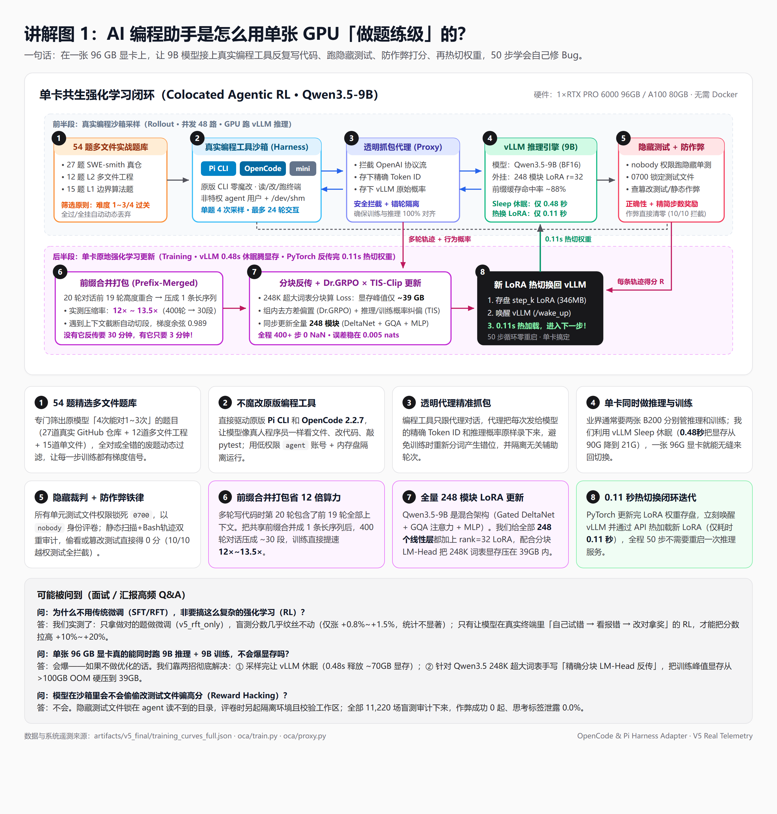
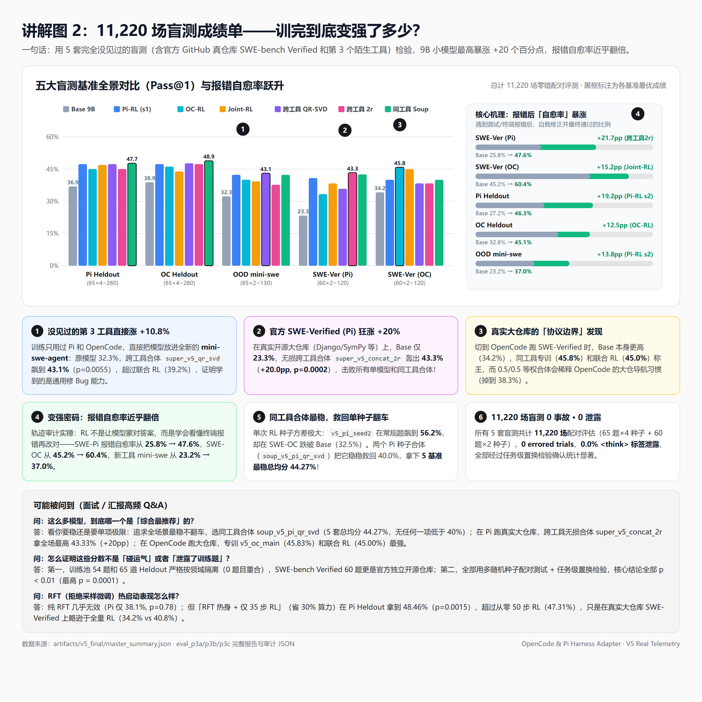
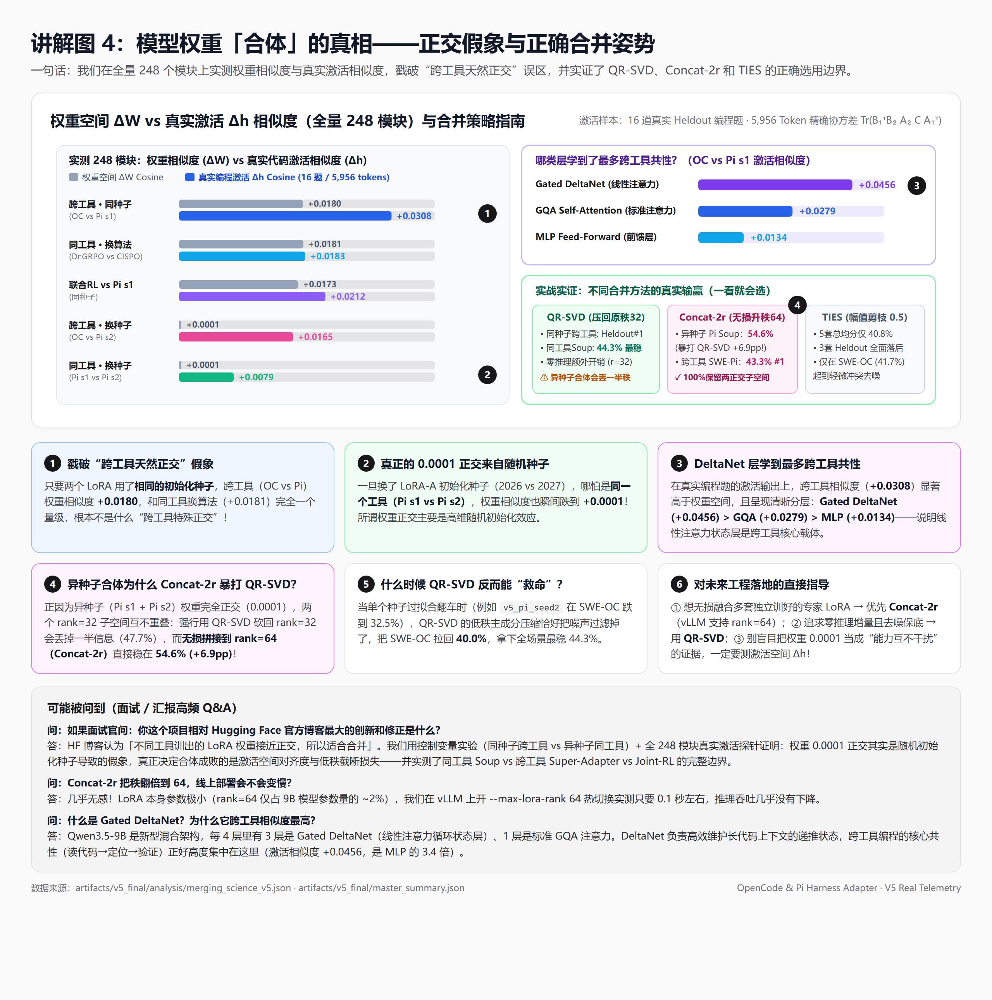

# OpenCode & Pi Harness Adapter (V5) —— 完整中文技术报告与零基础全流程解析

> **版本**：V5 Final（全部训练、5 大盲测基准、同工具 Soup 对照、248 模块激活正交探针、11,220 场轨迹审计 100% 零报错完结）  
> **代码仓库**：[XDE10/opencode-harness-adapter](https://github.com/XDE10/opencode-harness-adapter)（分支 `feat/v5-algo-infra-upgrade`）  
> **权重发布**：[HuggingFace · `XDE10/Qwen3.5-9B-Harness-Adapters-v5`](https://huggingface.co/XDE10/Qwen3.5-9B-Harness-Adapters-v5)（8 套精选 LoRA 权重 + 4 张图解 + 全量原始 JSON）  
> **英文技术报告**：[docs/V5_REPORT_EN.md](V5_REPORT_EN.md)

---

## 目录

1. [一分钟速览：项目在做什么、取得了什么核心成果？](#1-一分钟速览项目在做什么取得了什么核心成果)
2. [四张零基础讲解图（架构 · 成绩 · 算法 · 融合）](#2-四张零基础讲解图架构--成绩--算法--融合)
3. [任务数据、评测体系与三套编程 Harness 接入](#3-任务数据评测体系与三套编程-harness-接入)
4. [单卡共生 RL 系统架构与完整超参数配置](#4-单卡共生-rl-系统架构与完整超参数配置)
5. [算法原理对比、7 组全量训练遥测与 GSPO 退化分析](#5-算法原理对比7-组全量训练遥测与-gspo-退化分析)
6. [11,220 场全量盲测结果深度拆解（Pass@1 / Pass@k / L1-L3 / 效率）](#6-11220-场全量盲测结果深度拆解pass1--passk--l1-l3--效率)
7. [轨迹行为审计：模型到底是怎么变强的？](#7-轨迹行为审计模型到底是怎么变强的)
8. [248 模块融合科学（Merging Science）：权重 ΔW、激活 Δh 与几何范数](#8-248-模块融合科学merging-science权重-δw激活-δh-与几何范数)
9. [局限性、工程避坑实录与未来方向](#9-局限性工程避坑实录与未来方向)
10. [复现命令与面试高频追问速查](#10-复现命令与面试高频追问速查)

---

## 1. 一分钟速览：项目在做什么、取得了什么核心成果？

当前开源小模型（如 9B 参数量）直接接入真实终端编程工具（如 `OpenCode`、`Pi CLI`）修真实仓库 Bug 时，普遍存在“在终端里死循环敲 bash、看不懂报错不敢改代码、上下文越跑越长爆预算”的问题。Hugging Face 在 *Harness Adapters* 中提出针对不同编程框架分别做强化学习（RL）并合并权重，但原方案依赖 **2×B200 集群 + Docker/Harbor** 基础设施，成本高昂，且留下了多个未经严格检验的科学问题（例如：分开训再合体 vs 直接联合 RL 谁更强？“跨工具权重正交”是真特性还是假象？同工具多模型集成 Soup 能否打平跨工具融合？）。

本项目基于 **`Qwen/Qwen3.5-9B`（非思考模式，全量 248 模块 LoRA `r=32`）** 完成了从底层单卡系统到顶层科学验证的全链路闭环：

- **工程定位（单张 96 GB GPU 替代多卡集群，免 Docker）**：实现 `0.48s` vLLM Sleep 显存卸载、`0.11s` LoRA 热切换、`12×–13.5×` 多轮前缀合并打包、248K 词表精确分块 LM-Head 反传（峰值训练显存 `~39–42 GiB`），累计 400+ RL 步 **0 NaN、0 OOM、0 vLLM 重启**。
- **核心评估结论（5 套盲测基准、11,220 场配对评测、0 错例、0 思考标签泄露）**：
  - **最稳健的单模型头条指标**：同工具合并模型 `soup_v5_pi_qr_svd` 在全部 5 套盲测上的总均分从 **`33.12% → 44.27%`（`+11.15 pp`）**，5 项全部高于 Base（`40.0%–48.9%`）且无偏科；单模型 `v5_pi_drgrpo_tis` 5 项均分为 **`43.55%`（`+10.43 pp`）**。
  - **训练未见过的第 3 套编程框架 `mini-swe-agent v2`**：零样本迁移从 `32.31% → 42.31%–44.62%`（**`+10.0~+12.3 pp`, `p≤0.0055`**），多文件 `repo_pytest` 子集从 `1.7% → 13.8%`（绝对值仍偏低，起点仅约 1 题）。
  - **纯 Python 无 Docker `SWE-bench_Verified` 60 题子集**（Django 36 + SymPy 22 + Requests 2）：各基准最佳单臂在 Pi 上达 `43.33%`（`super_v5_concat_2r`, `+20.00 pp`, `p=0.0002`）、在 OpenCode 上达 `45.83%`（`v5_oc_main`, `+11.67 pp`, `p=0.0057`）。注：单榜峰值存在跨臂挑选偏差且置信区间较宽，对外评估以 5 项均分为准。
  - **关于 Super-Adapter 的真实阴性/中性结论**：跨工具 0.5/0.5 合并（`super_*` 5 项均分 `40.76%–42.45%`）**并未超过**单工具 `v5_pi_drgrpo_tis`（`43.55%`）、同工具 `soup_v5_pi_qr_svd`（`44.27%`）或联合训练 `v5_joint_oc_pi`（`42.67%`），未呈现“1+1>2 的异构技能叠加”；而同工具 `soup` 有效修复了单种子“玻璃大炮” `v5_pi_seed2`（均分 `45.22%`，但 `SWE-OC` 跌至 `32.50%` 低于 Base）的跨框架坍塌。
- **三项实证观察与证据分级**：
  1. **证伪“跨工具天然权重正交”（强证据）**：全 248 模块精确权重 $\Delta W$ 对照证明，`0.0001` 权重正交是 **LoRA-A 初始化种子效应**（同工具换种子也是 `+0.0001`，同种子跨工具反为 `+0.0180`）；在 16 条 prompt 上观测到激活余弦略高于权重空间（均值 `+0.0308`，中位数 `+0.0155`，绝对值很小，仅属微弱正向偏移，不足以宣称强对齐）。
  2. **GSPO 多轮前缀崩塌假说（有力现象 + 待验证因果）**：序列级 `GSPO` 后期打包段数由 `29→238`、单步反传耗时升至 `1,177s`（慢 5–6 倍）、盲测 `43.85%`（4 路最低）；轨迹检查指向重复闭合标签 `</function></function>` 经模板规范化后破坏 BPE 前缀单调性（单步 215 次重切），待“清理重复标签后重训”对照实验闭环验证。
  3. **行为归因与权重几何相关性（行为实证强、几何属相关性）**：RL 变强主要源于工具使用纪律改善——报错自愈率大幅上升（`SWE-Pi` `25.8%→47.6%`）、结构化 `edit` 占比从 `1.5%` 提至 `5.3%`；同时观测到 RFT 权重 Frobenius 范数是纯 RL 的 `1.8×–2.0×`，与 `RFT+RL` 同分布提分快但 OOD 真仓略弱的表现相关。

---

## 2. 四张零基础讲解图（架构 · 成绩 · 算法 · 融合）

### 讲解图 1：AI 编程助手是怎么用单张 GPU「做题练级」的？


### 讲解图 2：11,220 场盲测成绩单——训完到底变强了多少？


### 讲解图 3：4 种主流 RL 算法大比拼 & 我们抓出的 GSPO 底层陷阱


### 讲解图 4：模型权重「合体」的真相——正交假象与正确合并姿势


---

## 3. 任务数据、评测体系与三套编程 Harness 接入

### 3.1 训练题库：54 题多文件实战筛选池（`protocol/screen_v5_multifile.json`）
GRPO 类组内对比算法如果在某题上 4 次全对或 4 次全错，组内方差为 0，梯度为零。因此我们先对候选多文件任务用基座模型 `Qwen3.5-9B` 跑多轮预筛选，冻结了一套 **72.2% 为多文件真实仓库**的高信息密度训练池（共 **54 题**）：
- **27 题 `SWE-smith-py` 真实 Python 开源仓库 Bugfix**（源自真实开源项目，带完整 `pytest` 回归套）；
- **12 题 L2 `repo_pytest` 多文件工程项目**（3–4 模块跨文件依赖，经过自动化三重对照校验）；
- **15 题 L1 复杂状态机/边界算法单文件题**。
- 训练期进一步开启 **Dynamic Sampling（1.5× 过采样 + `filter_same_correctness`）** 与 **Early Cutoff**，动态丢弃全对/全错组并取消拖后腿长尾进程，保证每一步都有 6 组有效梯度。

### 3.2 严格隔离的 5 大盲测基准（总计 11,220 场零错评测）
经脚本逐项核验，54 题训练池（含 9 个 SWE-smith 仓库：`sqlparse` / `bottle` / `chardet` / `textfsm` / `tomli` / `tenacity` / `schema` / `python-string-similarity` / `oauthlib`）与 65 题 Heldout、60 题 `SWE-bench_Verified`（及官方全部 12 个仓库）均满足 **0 ID 重合、0 领域重合、0 仓库重合**；此外，Base 模型在 54 题训练池上的 Step 0 预筛基线通过率为 **`43.52%`**（`protocol/screen_v5_multifile.json`，单题区间 `25%–75%`）：

| 评测套件 | 题目来源与构成 | 驱动工具 (Harness) | 种子数 | 单模型样本量 | 本项目评估模型数 | 累计有效 Trials |
| :--- | :--- | :--- | :-: | :-: | :-: | :-: |
| **`pi_heldout`** | 65 题严格领域隔离 Heldout（L1 单文件 + L2 多文件工程 + L3 真实 OSS 历史 Commit） | Pi CLI `0.73.1` | 4 (`101–104`) | 260 | 15 | **3,900** |
| **`oc_heldout`** | 同上 65 题严格隔离 Heldout | OpenCode `2.2.7` | 4 (`101–104`) | 260 | 12 | **3,120** |
| **`mini_swe_heldout`** | 同上 65 题，测试**训练完全未见过的第 3 框架** OOD 迁移 | `mini-swe-agent v2` | 2 (`101–102`) | 130 | 12 | **1,560** |
| **`swe_verified_pi`** | 无 Docker 纯 Python **`SWE-bench_Verified` 60 题子集**（Django 36 / SymPy 22 / Requests 2） | Pi CLI `0.73.1` | 2 (`101–102`) | 120 | 12 | **1,440** |
| **`swe_verified_oc`** | 同上无 Docker 纯 Python **`SWE-bench_Verified` 60 题子集** | OpenCode `2.2.7` | 2 (`101–102`) | 120 | 10 | **1,200** |
| **合计** | — | **3 类真实编程 CLI** | — | — | — | **11,220 (0 err)** |

*注（无 Docker SWE 评测边界）*：60 题均通过 `base=fail / gold=pass` 双向准入门禁，且判分逻辑强制要求 `returncode == 0 and total > 0 and passed == total`（不存在空补丁或 0 命中假阳性）；但存在三项受限于无 Docker 环境的妥协——(1) 96.7% 集中于 Django 与 SymPy 两个仓库；(2) 统一运行于 Python 3.11 + 现代依赖 venv；(3) `pytest` 仓（SymPy/Requests）在 [swe_verified.py](../oca/benchmarks/swe_verified.py) 中截断了回归测例上限 `p2p[:25]`（`-k` 截断前 30 项），不等同于官方全量 Docker 回归评测。

### 3.3 三套编程 Harness 的系统特性与适配实录
1. **`Pi CLI 0.73.1`**：极简 4 工具（`bash` / `read` / `edit` / `write`），纯追加式消息历史，上下文几乎不重排，因此前缀合并压缩率高达 **`12.2×–13.0×`**，信噪比最高。
2. **`OpenCode 2.2.7`**：功能丰富的真实 IDE 级 CLI（`shell` / `read` / `edit` / `glob` / `grep` / `write` / `skill` 等），在基座状态下跑真实大仓比 Pi 强 `+10.8 pp`（`34.17%` vs `23.33%`），但内置上下文压缩与系统消息插入会导致更多前缀切分（压缩率 `5.72×`）。
3. **`mini-swe-agent v2`（第 3 未见 OOD 框架）**：纯 Bash 单工具交互范式，与 Pi/OpenCode 的工具接口完全不同。接入过程中我们定位并修复了其 v2 版本首次运行向导阻塞（注入 `MSWEA_CONFIGURED=true`）以及自定义覆盖未继承内置 `mini.yaml` 的问题（提交 `5056d43`，含全套单测与 live smoke 校验）。

---

## 4. 单卡共生 RL 系统架构与完整超参数配置

### 4.1 单卡 96 GB（/ 80 GB）五大核心系统优化
1. **vLLM Sleep + 0.11 秒 LoRA 热切**：采样阶段 vLLM 占 `~91 GiB`（并发 48–64 路，前缀缓存命中率 `~88%`）；进入训练时调 `/sleep?level=1`（仅耗时 **`0.48s`**，显存骤降至 `21.6 GiB`）；PyTorch 更新完 LoRA 后调 `/wake_up` + `/v1/load_lora_adapter` 热加载新权重（仅 **`0.10–0.12s`**），50 步全程零重启。
2. **Engine-Boundary `CaptureProxy`（`oca/proxy.py`）**：拦截 Harness ↔ vLLM 之间的 OpenAI 兼容 SSE 流，直接向 vLLM 请求 `return_token_ids=True` 与 `processed_logprobs`，将**精确推理 Token ID 与行为策略 logprob** 落盘；彻底杜绝重分词偏差，同时隔离 OpenCode 的标题摘要等非策略辅助调用，并支持安全拦截（`safe_intercept=True`）。
3. **Prefix-Merged Multi-Turn Packing（`oca/train.py`）**：多轮 Agent 对话前 $t-1$ 轮与第 $t$ 轮共享绝大部分前缀。合并共享前缀后将 ~400 轮对话压成 ~30 条长序列（**12×–13.5× 压缩**），检测到上下文改写/压缩时自动断开新起一段，实测与逐轮反传的梯度余弦达 `0.989`。
4. **Exact Chunked LM-Head Backward**：`Qwen3.5-9B` 词表高达 248K，直接算整段 logits 会瞬间 >100 GB OOM。我们按 `lm_head_chunk_size=2048` 精确分块计算 logprob 与梯度（数值误差 `0.000e+00`），将 248 模块全量 LoRA 训练峰值显存稳稳锁在 **`39–42 GiB`**。
5. **全量 248 模块混合架构 LoRA**：`Qwen3.5-9B` 是 3:1 混合架构（Gated DeltaNet 线性注意力 + GQA 标准注意力 + MLP）。V5 在原有 128 模块基础上新增全部 5 类 DeltaNet 投影（`in_proj_qkv`、`in_proj_z`、`in_proj_b`、`in_proj_a`、`out_proj`），覆盖全部 **248 个线性模块**（`r=32, alpha=64`，单权重 `346 MB`）。

### 4.2 冻结超参数与环境配置（`protocol/oca-v5.json`）

| 模块 | 关键配置项 | V5 冻结取值 |
| :--- | :--- | :--- |
| **基座模型** | Model / Mode / Parser | `Qwen/Qwen3.5-9B` (BF16) · `enable_thinking=False` · `qwen3_coder` |
| **LoRA 结构** | Rank / Alpha / Scope / Seed | `r=32`, `alpha=64`（`Concat-2r` 为 `r=64`）, 全量 **248 模块**（GQA+MLP+DeltaNet）, 默认种子 `2026`（`seed2` 用 `2027`） |
| **采样 Rollout** | Temp / Top-p / Budget / Sandbox | `temp=0.8`, `top_p=1.0`, `max_ctx=32768`, `max_out/call=2048`, `max_out/trial=10240`, `max_calls=24`, `timeout=300s`, `/dev/shm` + `agent` 低权限 + `bwrap` |
| **奖励函数** | Correctness + Efficiency + Anti-Hack | 二值隐藏单测通过 + 精简步数/Token 奖励（`eff_w=0.05`, 预算 24 轮 / 8192 tok）+ 静态/Bash/测试篡改检测（作弊清零） |
| **RL 优化器** | Steps / Batch / LR / Grad | `50` steps（`RFT+RL` 为 `35` steps）, `6 tasks × 4 rollouts`（过采样 1.5×）, `minibatches=2`, `lr=2e-5`, `max_grad_norm=1.0` |
| **主损失配置** | Adv / Loss / Clip / TIS | `Dr.GRPO`（去 std 除数偏置）+ `TIS-Clip`（`tis_cap=2.0`, `clip_low=0.20`, `clip_high=0.28`）, Token 级归一化 |

---

## 5. 算法原理对比、7 组全量训练遥测与 GSPO 退化分析

### 5.1 四种 RL 损失与 RFT 对照的核心差异
- **`Dr.GRPO + TIS-Clip`（主方法）**：优势函数仅减组均值 $A_i = R_i - \bar{R}$（避免小方差组被除以 $\sigma$ 放大噪声），用截断重要性权重 $\min(\exp(\log \pi_\theta - \log \pi_{\text{vllm}}), 2.0)$ 校正 BF16 推理与训练引擎的微小数值差，并叠加非对称 DAPO Clip-Higher（`[0.80, 1.28]`）。
- **`CISPO`**：对重要性比率直接做 Token 级软裁剪停梯度权重，不截断外层 logprob 梯度，鼓励紧凑高置信度输出。
- **`Turn-Credit`**：在结果奖励基础上引入分轮次信用折现（`turn_credit_weight=0.2`），强化后期定位与最终修改轮次的梯度比重。
- **`GSPO`**：按整条回复的几何平均概率比 $\exp(\frac{1}{|y_i|}\sum_t (\log\pi_\theta - \log\pi_{\text{old}}))$ 做序列级裁剪（`[0.997, 1.004]`）。
- **`RFT` / `RFT + RL`**：先从基座模型在训练池的过关轨迹中筛选 175 条高质量样本做 2 轮 SFT（loss `0.1295 → 0.1181`），得到 `v5_rft_only`，再以此热启动跑 **35 步** `Dr.GRPO+TIS`（省 30% RL 算力）得到 `v5_rft_plus_rl`。

### 5.2 全量 7 组 RL 训练实测遥测总表（源自 `artifacts/v5_final/training_curves_full.json`）

| 训练任务 | 步数 | 前10步均通过 | 后10步均通过 | 峰值通过 | 打包段数<br>*(中位/最大)* | 中位压缩比 | 最大前缀重切 | 反传耗时<br>*(中位/最大)* | 热切耗时 | Logprob 均误差 | 峰值显存 | 总墙钟耗时 |
| :--- | :-: | :-: | :-: | :-: | :-: | :-: | :-: | :-: | :-: | :-: | :-: | :-: |
| **`v5_pi_drgrpo_tis`** | 50 | `68.9%` | **`71.4%`** | **`90.9%`** | `31 / 42` | `12.21×` | `18` | `157s / 406s` | `0.104s` | `0.00505` | `40.7 GiB` | `8.11 h` |
| **`v5_pi_cispo`** | 50 | `62.1%` | `60.9%` | `81.2%` | `31 / 40` | **`12.97×`** | `17` | `205s / 652s` | `0.365s` | `0.00496` | `40.6 GiB` | `10.57 h` |
| **`v5_pi_gspo`** ⚠️ | 50 | `67.5%` | `60.4%` | `82.5%` | **`67 / 238`** | **`5.58×`** *(末步1.71×)* | **`215`** | **`319s / 1177s`** | `0.103s` | `0.00498` | `42.1 GiB` | `11.44 h` |
| **`v5_pi_turn_credit`** | 50 | `70.1%` | `69.9%` | `85.4%` | `32 / 47` | `10.84×` | `23` | `157s / 219s` | `0.120s` | `0.00486` | `40.9 GiB` | `8.10 h` |
| **`v5_oc_main`** | 50 | `56.8%` | `67.1%` | `87.5%` | `66 / 135` | `5.72×` | `111` | `377s / 816s` | `0.112s` | `0.00507` | `40.5 GiB` | `11.65 h` |
| **`v5_joint_oc_pi`** | 50 | `50.3%` | `56.1%` | `72.7%` | `42 / 62` | `8.79×` | `38` | `281s / 446s` | `0.441s` | `0.00534` | `40.5 GiB` | `12.90 h` |
| **`v5_rft_plus_rl`** | 35 | `69.3%` | `70.9%` | `80.8%` | `32 / 45` | `11.76×` | `21` | `171s / 255s` | `0.106s` | `0.00440` | `40.6 GiB` | **`5.75 h`** |

*(注 1：另有第 8 组重复种子训练 `v5_pi_seed2` 在 A100 80G 跑满 50 步，末步通过率 `64.6%`、最高 `79.2%`、打包稳在 `24–40` 段。)*  
*(注 2 — 关于训练曲线为何相对平缓：Base 模型在 54 题池上的 Step 0 真实基线为 `43.52%`；训练期 `pass_rate` 起手即处于 `50%–70%` 且后 40 步涨幅不大（如 `drgrpo_tis` `68.9% → 71.4%`、`cispo` `62.1% → 60.9%`），除前几步快速适配外，核心统计原因是开启了 `early_cutoff=True` + `1.5×` 过采样——每步只要最先跑完的 6 个非零方差组达标即取消剩余长尾慢组，`pass_rate` 仅在未取消的较快完成组上统计，存在系统性生存者偏差，叠加 50 步小批量高方差所致。)*

### 5.3 算法观察与机理假说：为什么 `GSPO` 在多轮 Coding Agent 下退化？
从上表可以清晰看到，`v5_pi_gspo` 在同硬件同数据集上后期出现明显退化：
1. **实测现象**：打包段数从 Step 1 的 `29` 段升至 Step 50 的 **`238` 段**（前缀压缩比从 `13×` 跌至 **`1.71×`**），单步反传时间从 `180s` 恶化至 **`1,177s`（近 20 分钟/步，慢 5–6 倍）**，盲测 `Pi Heldout` 仅 `43.85%`（4 路算法最低，`p=0.0677` 不显著），且审计中触发全场最多的 **`9` 次安全拦截**。
2. **根因假说与边界**：`GSPO` 使用序列级几何平均归一（$1/N_i$），对长输出末尾出现的个别格式冗余 Token 惩罚被摊薄，日志中观察到后期频发重复闭合标签 `</function>\n</function>\n</tool_call>`。工具解析器容错执行了该调用，但**下一轮框架通过 Qwen 聊天模板重渲染历史消息时，会把重复闭合标签规范化为单个 `</function>`**，导致历史 Token 序列被改写并击穿多轮 BPE 前缀单调性（单步触发 `215` 次前缀重切分）。需要说明：(a) 该因果链目前属有力假说，尚缺“清理重复闭合标签后重训”的闭环对照；(b) “变慢”高度依赖本项目的前缀合并打包实现，且 GSPO 的裁剪区间 `[0.997, 1.004]` 未做网格调参；(c) 4 种算法仅单种子运行，分数差（`43.85%–47.31%`）小于同配方换种子的方差（`8.84 pp`），不足以对算法绝对优劣下终局定论。

---

## 6. 11,220 场全量盲测结果深度拆解（Pass@1 / Pass@k / L1-L3 / 效率）

### 6.1 五大盲测基准总榜（Pass@1，全部 0 errored trials）

| 排名 / 模型 | **5 基准总均分** | 3-Heldout 均分 | 2-SWE 均分 | Pi Heldout *(65×4)* | OC Heldout *(65×4)* | OOD `mini-swe` *(65×2)* | SWE-Verified (Pi) *(60×2)* | SWE-Verified (OC) *(60×2)* |
| :--- | :---: | :---: | :---: | :---: | :---: | :---: | :---: | :---: |
| **`Base` (Qwen3.5-9B)** | `33.12%` | `36.03%` | `28.75%` | `36.92%` | `38.85%` | `32.31%` | `23.33%` | `34.17%` |
| 1. `v5_pi_seed2` | **`45.22%`** | **`50.64%`** | `37.09%` | **`56.15%`** *(p=.0001)* | **`51.15%`** *(p=.0018)* | **`44.62%`** *(p=.0018)* | `41.67%` *(p=.0003)* | `32.50%` *(p=.865)* |
| 2. **`soup_v5_pi_qr_svd`** | **`44.27%`** | `46.28%` | `41.25%` | `47.69%` *(p=.0022)* | `48.85%` *(p=.0135)* | `42.31%` *(p=.0387)* | `42.50%` *(p=.0007)* | `40.00%` *(p=.347)* |
| 3. `v5_pi_drgrpo_tis` | `43.55%` | `45.64%` | `40.41%` | `47.31%` *(p=.0049)* | `47.31%` *(p=.0121)* | `42.31%` *(p=.0049)* | `40.83%` *(p=.0003)* | `40.00%` *(p=.209)* |
| 4. `soup_v5_pi_concat_2r` | `43.05%` | `47.31%` | `36.66%` | `54.62%` *(p=.0001)* | `45.77%` *(p=.0945)* | `41.54%` *(p=.0117)* | `40.00%` *(p=.0009)* | `33.33%` *(p=1.00)* |
| 5. `v5_joint_oc_pi` | `42.67%` | `43.33%` | **`41.66%`** | `46.92%` *(p=.0087)* | `43.85%` *(p=.1645)* | `39.23%` *(p=.0479)* | `38.33%` *(p=.0057)* | `45.00%` *(p=.0298)* |
| 6. `super_v5_qr_svd` | `42.45%` | `46.03%` | `37.08%` | `47.31%` *(p=.0050)* | `47.69%` *(p=.0054)* | `43.08%` *(p=.0055)* | `35.83%` *(p=.0353)* | `38.33%` *(p=.494)* |
| 7. `super_v5_concat_2r` | `42.33%` | `43.33%` | `40.83%` | `45.00%` *(p=.0499)* | `47.31%` *(p=.0062)* | `37.69%` *(p=.0654)* | **`43.33%`** *(p=.0002)* | `38.33%` *(p=.471)* |
| 8. `v5_oc_main` | `42.06%` | `43.72%` | `39.58%` | `45.00%` *(p=.0232)* | `46.15%` *(p=.0621)* | `40.00%` *(p=.0529)* | `33.33%` *(p=.0781)* | **`45.83%`** *(p=.0057)* |
| 9. `super_v5_ties` | `40.76%` | `41.54%` | `39.59%` | `41.54%` *(p=.0584)* | `45.38%` *(p=.0196)* | `37.69%` *(p=.2349)* | `37.50%` *(p=.0042)* | `41.67%` *(p=.144)* |
| `v5_rft_plus_rl` *(35步RL)* | — | `44.61%` | — | `48.46%` *(p=.0015)* | `46.92%` *(p=.0151)* | `38.46%` *(p=.076)* | `34.17%` *(p=.0212)* | — |
| `v5_rft_only` *(纯SFT)* | — | `37.18%` | — | `38.08%` *(p=.777)* | `39.62%` *(p=.903)* | `33.85%` *(p=.835)* | `26.67%` *(p=.557)* | — |
| `v5_pi_cispo` / `turn` / `gspo` | — | — | — | `46.15%` / `45.77%` / `43.85%` | — | — | — | — |

### 6.2 总表核心解读：玻璃大炮 vs 同工具 Soup 纠偏，以及 Super-Adapter 的阴性结论
从 6.1 完整总表可以读出三条比单纯“追单项第一”更有价值的实证结论：
1. **单种子“玻璃大炮”与同工具 Soup 的稳健纠偏**：`v5_pi_seed2` 虽然 5 项均分最高（`45.22%`），但在 `SWE-Verified (OC)` 上跌至 `32.50%`，**甚至低于原版 Base（`34.17%`）**；而将同工具双种子用 `QR-SVD` 合并得到的 `soup_v5_pi_qr_svd`（5 项均分 `44.27%`）将 `SWE-OC` 拉回 `40.00%`，成为 5 套盲测全部稳高于 Base、无一偏科的最稳健配置。
2. **Super-Adapter 的真实结论（阴性/中性）**：三个跨工具 0.5/0.5 合并模型（`super_v5_qr_svd` `42.45%`、`super_v5_concat_2r` `42.33%`、`super_v5_ties` `40.76%`）**5 项均分全部低于单工具 `v5_pi_drgrpo_tis`（`43.55%`）、同工具 `soup_v5_pi_qr_svd`（`44.27%`）与联合训练 `v5_joint_oc_pi`（`42.67%`）**。原因直观：`v5_oc_main` 的跨工具泛化偏弱（均分 `42.06%`），硬按 0.5/0.5 与 Pi 平均，既未保住 OpenCode 在 `SWE-OC` 上的优势（`45.83% → 38.33%`），也稀释了 Pi 的通用能力。结合第 7 章行为审计（RL 学到的是通用纠错与编辑纪律，而非特定工具的死规则），说明单在干净工具（Pi）上训好即可迁移，跨工具合并并未呈现“1+1>2 技能叠加”。
3. **单榜峰值与多重比较约束**：`super_v5_concat_2r` 在 `SWE-Pi` 的 `+20.00 pp` 属于单一基准上的最佳单臂，且 `60 × 2` 样本量置信区间宽（`[+10.8, +30.0]`）；此外 `gspo`/`cispo`/`turn_credit` 仅测了 `pi_heldout`，`rft` 组未测 `swe_verified_oc`，不宜据此夸大跨基准算法排序。

### 6.3 关键细分维度：`pass@k`、多文件 `repo_pytest` 变化与配对胜负比

| 评测套件 & 代表模型 | `pass@1` (95% CI Δ) | **`pass@4` / `pass@2`** | 配对胜/负<br>*(Wins/Loss)* | 多文件 `repo_pytest`<br>*(Base → LoRA)* | 单文件 `single_file`<br>*(Base → LoRA)* | 共解题 Token 节省 |
| :--- | :---: | :---: | :---: | :---: | :---: | :---: |
| **Pi Heldout** · `v5_pi_drgrpo_tis` | `47.31%` `[+3.9, +17.3]` | `55.4% →` **`69.23%`** | `47 / 20` | `12.1% →` **`24.1%` (2.0×)** | `56.9% → 66.0%` | **`+17.25%`** |
| **Pi Heldout** · `v5_pi_cispo` | `46.15%` `[+1.9, +16.9]` | `55.4% → 61.54%` | `43 / 19` | `12.1% →` **`25.9%` (2.1×)** | `56.9% → 62.5%` | **`+31.66%`** *(最省)* |
| **Pi Heldout** · `soup_v5_pi_concat_2r` | `54.62%` `[+10.0, +25.8]` | `55.4% → 67.69%` | `58 / 12` | `12.1% →` **`32.8%` (2.7×)** | `56.9% → 72.2%` | `+7.28%` |
| **Pi Heldout** · `v5_pi_seed2` | `56.15%` `[+11.5, +26.9]` | `55.4% →` **`72.31%`** | **`60 / 10`** | `12.1% → 31.0%` | `56.9% → 76.4%` | `-17.46%` |
| **OC Heldout** · `super_v5_qr_svd` | `47.69%` `[+3.5, +15.0]` | `55.4% →` **`66.15%`** | `38 / 15` | `12.1% → 19.8%` | `60.4% → 70.1%` | **`+12.41%`** |
| **OC Heldout** · `v5_pi_drgrpo_tis` | `47.31%` `[+2.7, +15.0]` | `55.4% →` **`66.15%`** | `38 / 16` | `12.1% → 20.7%` | `60.4% → 68.8%` | **`+20.07%`** |
| **OOD `mini-swe`** · `super_v5_qr_svd` | `43.08%` `[+3.9, +17.7]` | `36.9% →` **`55.38%`** | `18 / 4` | **`1.7% → 13.8%` (8.1×!)** | `56.9% → 66.7%` | **`+9.25%`** |
| **SWE-Ver (Pi)** · `super_v5_concat_2r` | **`43.33%`** `[+10.8, +30.0]` | `31.7% →` **`53.33%`** | **`28 / 4`** *(7:1)* | 官方 60 题真仓 | — | **`+13.55%`** |
| **SWE-Ver (OC)** · `v5_oc_main` | **`45.83%`** `[+4.2, +19.2]` | `41.7% → 55.00%` | **`18 / 4`** | 官方 60 题真仓 | — | `-16.13%` |
| **SWE-Ver (OC)** · `v5_joint_oc_pi` | `45.00%` `[+2.5, +19.2]` | `41.7% →` **`56.67%`** | `20 / 7` | 官方 60 题真仓 | — | `-17.32%` |

*(注：正的 Token 节省表示在配对共同解决的题目上消耗更少 Token；负值表示模型为攻克复杂题倾向做更充分的多步验证。)*

---

## 7. 轨迹行为审计：模型到底是怎么变强的？

我们对全部 11,220 场轨迹运行了自动化行为审计（`oca/audit_trajectories.py`），发现 **3 个极具说服力的行为转变**：

1. **零作弊、零 `<think>` 泄露**：所有 5 套基准 11,220 场轨迹的 `<think>` 标签泄露率全部为 **`0.0%`**，作弊成功数为 **`0`**（极少数试图越权的尝试全部被 `SafeAgents` 拦截归零）。
2. **报错自愈率（Error Recovery Rate）显著提升**：统计所有在执行终端/测试时遇到过报错的轨迹，看最终能自我定位并修正通过的比例：
   - **`SWE-Verified (Pi)`**：`Base 25.8%` → `v5_pi_drgrpo_tis 45.1%` → **`super_v5_concat_2r 47.6%`**（**+21.8 pp**）；
   - **`SWE-Verified (OC)`**：`Base 45.2%` → `v5_oc_main 55.6%` → `v5_pi_drgrpo_tis 57.8%` → **`v5_joint_oc_pi 60.4%`**（**+15.2 pp**）；
   - **`Pi Heldout`**：`Base 27.2%` → `super_v5_qr_svd 37.8%` → **`v5_pi_seed2 46.3%`**（**+19.1 pp**）；
   - **`OOD mini-swe`**：`Base 23.2%` → `v5_pi_drgrpo_tis 33.3%` → `soup_v5_pi_qr_svd 35.4%` → **`v5_pi_seed2 37.0%`**（**+13.8 pp**）。
3. **工具使用习惯转变 + 失败归因转移**：
   - 在 **`SWE-Verified (Pi)`** 上，Base 把 **`77.7%`** 的调用都花在重复敲 `bash`，结构化 `edit` 仅占 **`1.5%`**，导致 `120` 场中有 **`81` 场超时耗尽预算**（`budget_or_timeout`）；
   - RL 之后，`v5_pi_drgrpo_tis` 将 `bash` 降到 `69.0%`，`read` 提到 `25.5%`，结构化 `edit` 占比从 `1.5%` 升至 **`5.3%`（3.5×）**；`super_v5_concat_2r` 将超时失败从 `81` 场降至 **`58` 场（减少 28.4%）**，通过数从 `28` 增至 **`52` 场**。

---

## 8. 248 模块融合科学（Merging Science）：权重 ΔW、激活 Δh 与几何范数

### 8.1 精确激活协方差探针：戳破“跨工具天然正交”假象
我们在空闲 A100 上加载基座 `Qwen3.5-9B`，用 16 道真实 Heldout 编程题前向传播采集全部 **248 个 LoRA 适配线性层**的精确输入激活协方差矩阵 $C_m = \frac{1}{N} X_m^\top X_m$（每模块 `5,956` 个真实代码 Token），从而无需重跑模型即可精确计算任意一对 LoRA 的：
- **权重空间余弦**：$\cos(\Delta W_1, \Delta W_2) = \frac{\mathrm{Tr}((B_1^\top B_2)(A_2 A_1^\top))}{\|\Delta W_1\|_F \|\Delta W_2\|_F}$
- **激活输出余弦**：$\cos(\Delta W_1 X, \Delta W_2 X) = \frac{\mathrm{Tr}((B_1^\top B_2)(A_2 C_m A_1^\top))}{\|\Delta W_1 X\|_F \|\Delta W_2 X\|_F}$

| 对比组 | LoRA 初始化种子 | $\Delta W$ 总均值 | DeltaNet $\Delta W$ | GQA $\Delta W$ | MLP $\Delta W$ | **$\Delta h$ 总均值** | **DeltaNet $\Delta h$** | **GQA $\Delta h$** | **MLP $\Delta h$** |
| :--- | :---: | :---: | :---: | :---: | :---: | :---: | :---: | :---: | :---: |
| 跨工具 `OC` vs `Pi s1` | **同 (`2026`)** | `+0.0180` | `+0.0245` | `+0.0188` | `+0.0095` | **`+0.0308`** | **`+0.0456`** | `+0.0279` | `+0.0134` |
| 同工具换算法 `Dr.GRPO` vs `CISPO` | **同 (`2026`)** | `+0.0181` | `+0.0172` | `+0.0218` | `+0.0179` | `+0.0183` | `+0.0135` | `+0.0308` | `+0.0201` |
| 同工具换算法 `Dr.GRPO` vs `Turn` | **同 (`2026`)** | `+0.0184` | `+0.0226` | `+0.0079` | `+0.0168` | `+0.0163` | `+0.0190` | `+0.0071` | `+0.0161` |
| 联合 RL vs `Pi s1` | **同 (`2026`)** | `+0.0173` | `+0.0164` | `+0.0168` | `+0.0186` | `+0.0212` | `+0.0204` | `+0.0234` | `+0.0215` |
| 跨工具 `OC` vs `Pi s2` | **异 (`26/27`)** | `+0.0001` | `+0.0001` | `+0.0001` | `+0.0001` | **`+0.0165`** | `+0.0178` | `+0.0201` | `+0.0138` |
| 同工具换种子 `Pi s1` vs `Pi s2` | **异 (`26/27`)** | **`+0.0001`** | `+0.0002` | `+0.0001` | `+0.0001` | `+0.0079` | `+0.0023` | `+0.0172` | `+0.0119` |

**三条实证结论与边界**：
1. **“权重正交 (`0.0001`)”主要是初始化种子效应，而非跨工具特性（强证据）**：在 50 步小学习率（`lr=2e-5`）下，LoRA 权重范数仅 `~0.06–0.13`，更新基本停留在初始化矩阵 $A_0$ 张成的子空间内。同工具换种子（`Pi s1` vs `Pi s2`）权重余弦也是 `+0.0001`；而同种子跨工具（`OC` vs `Pi s1`）为 `+0.0180`，与同工具换算法（`+0.0181`）完全一致，直接反驳了“跨工具天然正交”的粗糙归因。
2. **激活空间仅呈微弱正向偏移（克制表述，避免过度解读）**：在 16 条 Heldout prompt 上，跨工具同种子 `OC vs Pi s1` 的激活空间均值余弦为 **`+0.0308`**（中位数仅 **`+0.0155`**，跨 248 层分布 `[-0.238, +0.490]`），且呈 DeltaNet (`+0.0456`) > GQA (`+0.0279`) > MLP (`+0.0134`) 的相对排序。需要明确：**`0.03` 的绝对值非常小且缺乏零分布显著性检验，不能据此宣称“激活高度对齐”或“DeltaNet 是跨工具核心载体”**，后者仍需“仅合并 DeltaNet 层”的消融实验验证。
3. **权重几何范数与 RFT 泛化差异的相关性观察**：7 组纯 RL 权重收敛到几乎相同的范数与有效秩（`eff_rank ≈ 16.1–16.4`, `MLP frob ≈ 0.126–0.135`），而 2 轮 SFT（`v5_rft_only`）的 MLP 权重 Frobenius 范数达 `0.227`（`v5_rft_plus_rl` 达 **`0.253`**，为纯 RL 的 `1.8×–2.0×`）。这与 `RFT+RL` 在同分布提分快但 OOD 真实仓库略弱的表现一致，属相关性观察而非因果证明。

### 8.2 合并方法对比与适用边界
- **主成分压缩 `QR-SVD`（`r=32`）**：零推理额外开销，兼具低秩去噪效果——把翻车种子 `v5_pi_seed2` 在 `SWE-OC` 上从 `32.50%` 拉回 **`40.00%`**，使同工具 `soup_v5_pi_qr_svd` 取得最稳健的 5 基准均分 **`44.27%`**。
- **无损升秩拼接 `Concat-2r`（`r=64`）**：保留两个异种子正交子空间，在 `pi_heldout` 异种子合体中以 `54.62%` 高于 `QR-SVD`（`47.69%`）`+6.93 pp`，并在 `SWE-Pi` 上拿到单榜最高 `43.33%`；但在 `SWE-OC` 上未能修复 `seed2` 的下滑（`soup_v5_pi_concat_2r` 仅 `33.33%`）。
- **幅值剪枝 `TIES (0.5)`**：在 248 模块高维低秩更新下整体最弱（总均分 `40.76%`），仅在 `SWE-OC`（`41.67%`）略高于等权 `QR-SVD`/`Concat-2r`（`38.33%`）。

---

## 9. 局限性、工程避坑实录与未来方向

### 9.1 诚实局限性（Threats to Validity）
1. **单次 RL 种子方差显著大于多数算法间差距**：同配方仅换随机种子，`v5_pi_seed2` 在 `pi_heldout` 达 `56.15%` 却在 `swe_verified_oc` 跌至 `32.50%`（低于 Base `34.17%`）。因此单种子下 2–5 个百分点的差距不足以支撑算法优劣排序。
2. **无 Docker `SWE-bench_Verified` 60 题子集的环境与测试边界**：96.7% 集中于 `django`（36）和 `sympy`（22）（另有 `requests` 2 题），统一运行于 Python 3.11 venv，且 `pytest` 仓截断 `p2p[:25]`（`-k` 截断前 30 项）。此外，V5 评测流程未导出标准 `git diff`（`predictions.jsonl`）和本地单场轨迹 JSON，因此当前尚未经官方 Docker 复核；若做 V6，只需在 `rollout.py` 中增加 `git diff` 导出即可将核心 3–4 个模型的补丁拿到本地官方 Docker 独立复验。
3. **实验矩阵不完整与非思考模式设定**：`v5_pi_gspo`/`cispo`/`turn_credit` 仅测了 `pi_heldout`，`rft` 组缺 `swe_verified_oc`；评测采用 `temperature=0.8` 且 SWE 仅 2 种子，单题权重 `0.83%`。全程设置 `enable_thinking=False`（依据 V4 对照：在固定 `10,240` token 预算下的 OpenCode 65 题 Heldout 上，开启 thinking 使 token 增 `+85.9%` 而因预算截断导致 `pass@1` 持平 `40.77%`、`pass@4` 降 `6.16 pp`）；放宽预算并开启 thinking 后的 RL 边际收益留待 V6 验证。
4. **等权 0.5/0.5 跨工具合并的阴性结果与激活探针局限**：跨工具 `super_*` 5 项均分均低于单工具 Pi 与同工具 `soup`；激活余弦探针仅采样 16 条 prompt 且均值 `+0.0308` 偏小、缺少零分布基线，后续需扩大样本并做分层合并消融。

### 9.2 实战踩坑与工程避坑实录
- **失控子进程内存泄露防线**：评测期模型写出的 `match_glob` 死循环脚本曾占用 `163 GiB` 内存险些击穿 176G 宿主机，建议后续在 `rollout.py` 中对 `agent` 子进程强制加 `RLIMIT_AS` 内存上限。
- **跨机器环境依赖校验**：`oca-v5-eval2` 首次跑 `swe_verified_oc` 时因未装 `opencode` 导致 120 场瞬间全错，后增补启动前 `--version` 强校验彻底杜绝。
- **云端大文件严禁走本地代理中转**：所有 `> 50 MB` 的权重同步（Drive ↔ Colab ↔ HF）必须在云端机房纯 CPU 直推（本实验 8 套权重 34 秒直传完结、0 本地流量）。

---

## 10. 复现命令与面试高频追问速查

### 10.1 本地校验与复现主命令
```bash
# 1. 本地 26 项全量单测与防作弊套件验证（Windows / Linux / macOS）
python -m unittest discover -s tests -v
python -m oca.adversarial

# 2. 单卡 50 步全量 248 模块 LoRA RL（Dr.GRPO + TIS-Clip）
python -u -m oca.train --config protocol/oca-v5.json --mode train --harness pi \
  --task-ids-file protocol/screen_v5_multifile.json --out-dir /content/runs/v5_pi \
  --loss-mode tis_clip --adv-mode dr_grpo --use-deltanet-lora --dynamic-sampling --curriculum

# 3. CPU 1秒精确合并（支持 qr_svd / concat_2r / ties）
python -u -m oca.merge --method concat_2r \
  --adapter opencode=/content/ckpts/v5_oc_main:0.5 \
  --adapter pi=/content/ckpts/v5_pi_drgrpo_tis:0.5 \
  --out-dir /content/ckpts/merged/super_v5_concat_2r

# 4. 多随机种子配对评测与轨迹审计（支持 pi / opencode / mini_swe）
python -u -m oca.eval --config protocol/oca-v5.json --harness mini_swe --split heldout \
  --seeds 101 102 --out-dir /content/eval_mini --lora super=/content/ckpts/merged/super_v5_qr_svd
```

### 10.2 面试 30 秒电梯演讲版（克制实证口径）
> “我在单张 96G 显卡上搭了一套不依赖 Docker 的共生 Agentic RL 工程框架：通过 `0.48s` vLLM Sleep、`0.11s` LoRA 热切换、`CaptureProxy` 引擎边界精确录 logprobs 配合 `TIS-Clip` 纠偏、约 `12×` 多轮前缀合并打包和 248K 词表分块反传，对 `Qwen3.5-9B` 全量 248 模块跑多轮强化学习。在 5 套严格隔离盲测（共 11,220 场、0 报错）中，最稳健的同工具合并模型 `soup_v5_pi_qr_svd` 把 5 项总均分从 **`33.1%` 提到了 `44.3%`**（每项都高于基座），在训练未见过的第三套工具 `mini-swe-agent` 上也有约 **`+10 pp`** 的零样本迁移，审计显示提升主要来自报错自愈率上升和更精准的结构化编辑。同时我们也做了一些诚实的排雷对照：证伪了‘跨工具权重正交’（其实是初始化种子效应）、复现并定位了 `GSPO` 破坏前缀缓存变慢 5–6 倍的现象，也如实发现 0.5/0.5 跨工具 Super-Adapter 并没有超过同工具 Soup，反而是同工具 Soup 有效治好了单种子 RL 的跨框架偏科。”
