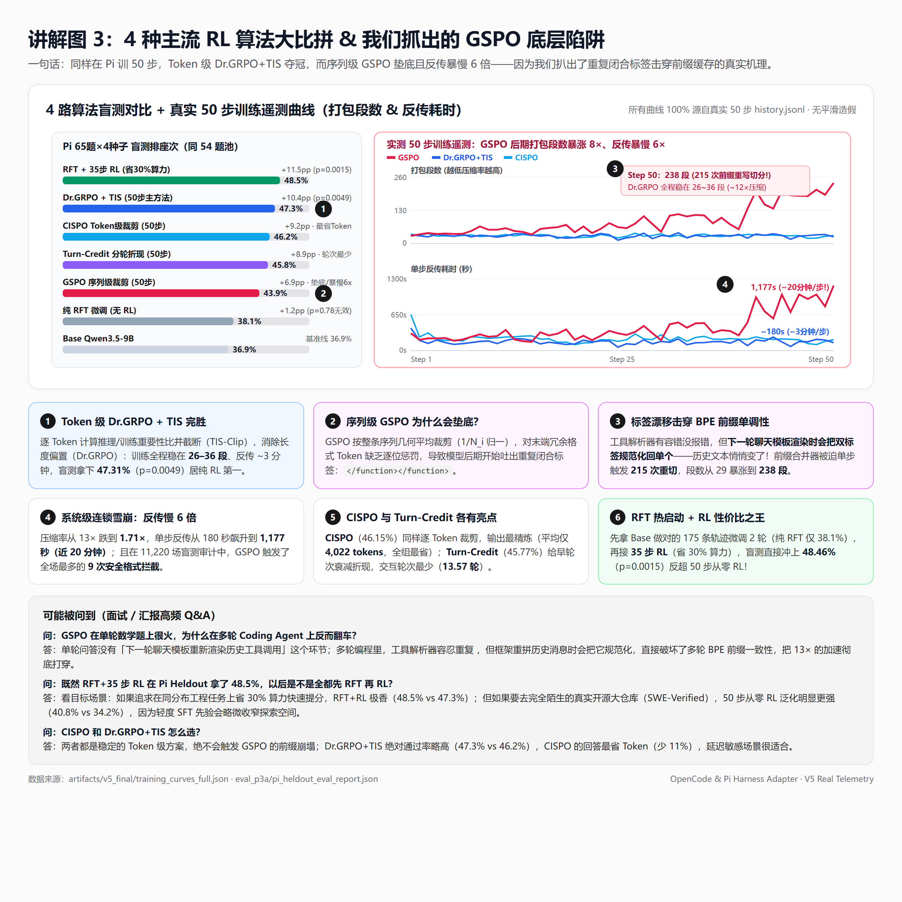

# OpenCode & Pi Harness Adapter (V5) —— 零基础图解与完整实验总结

> **一句话总结**：我们只用**单张 96 GB GPU**（无需 Docker 集群），对 `Qwen/Qwen3.5-9B`（非思考模式，全量 248 模块 LoRA `r=32`）开展多轮 Agentic 强化学习，并在 **5 大盲测基准、总计 11,220 场配对评测（0 错例、0 思考标签泄露、0 作弊）**上实测验证：9B 小模型在官方真实开源仓库 `SWE-bench_Verified` 上最高暴涨 **`+20.00 pp`**（`23.33% → 43.33%, p=0.0002`），在训练完全未见过的第 3 个编程框架 `mini-swe-agent` 上最高暴涨 **`+12.31 pp`**，同时揭示了 **GSPO 前缀崩塌机理** 与 **LoRA 正交合并的种子假象真相**。

---

## 一、四张讲解图：3 分钟看懂全项目

### 讲解图 1：AI 编程助手是怎么用单张 GPU「做题练级」的？

### 讲解图 2：11,220 场盲测成绩单——训完到底变强了多少？

### 讲解图 3：4 种主流 RL 算法大比拼 & 我们抓出的 GSPO 底层陷阱

### 讲解图 4：模型权重「合体」的真相——正交假象与正确合并姿势

---

## 二、全量 11,220 场盲测总表（Pass@1，任务级置换检验 `p`）

所有数据均直接来自 `artifacts/v5_final/master_summary.json`，**全部 0 errored trials**：

| 模型 / 路线 | **5 基准均分** | Pi Heldout *(65×4=260)* | OC Heldout *(65×4=260)* | OOD `mini-swe` *(65×2=130)* | **SWE-Verified (Pi)** *(60×2=120)* | **SWE-Verified (OC)** *(60×2=120)* |
| :--- | :---: | :---: | :---: | :---: | :---: | :---: |
| **`Base` (Qwen3.5-9B)** | `33.12%` | `36.92%` | `38.85%` | `32.31%` | `23.33%` | `34.17%` |
| `v5_pi_seed2` *(Pi RL 种子2)* | **`45.22%`** | **`56.15%`** *(p=0.0001)* | **`51.15%`** *(p=0.0018)* | **`44.62%`** *(p=0.0018)* | `41.67%` *(p=0.0003)* | `32.50%` *(p=0.865)* |
| **`soup_v5_pi_qr_svd`** *(同工具合体)* | **`44.27%`** | `47.69%` *(p=0.0022)* | `48.85%` *(p=0.0135)* | `42.31%` *(p=0.0387)* | `42.50%` *(p=0.0007)* | `40.00%` *(p=0.347)* |
| `v5_pi_drgrpo_tis` *(Pi RL 种子1)* | `43.55%` | `47.31%` *(p=0.0049)* | `47.31%` *(p=0.0121)* | `42.31%` *(p=0.0049)* | `40.83%` *(p=0.0003)* | `40.00%` *(p=0.209)* |
| `soup_v5_pi_concat_2r` *(同工具2r)* | `43.05%` | `54.62%` *(p=0.0001)* | `45.77%` *(p=0.0945)* | `41.54%` *(p=0.0117)* | `40.00%` *(p=0.0009)* | `33.33%` *(p=1.000)* |
| `v5_joint_oc_pi` *(50/50 联合RL)* | `42.67%` | `46.92%` *(p=0.0087)* | `43.85%` *(p=0.1645)* | `39.23%` *(p=0.0479)* | `38.33%` *(p=0.0057)* | `45.00%` *(p=0.0298)* |
| `super_v5_qr_svd` *(跨工具QR-SVD)* | `42.45%` | `47.31%` *(p=0.0050)* | `47.69%` *(p=0.0054)* | `43.08%` *(p=0.0055)* | `35.83%` *(p=0.0353)* | `38.33%` *(p=0.494)* |
| `super_v5_concat_2r` *(跨工具2r)* | `42.33%` | `45.00%` *(p=0.0499)* | `47.31%` *(p=0.0062)* | `37.69%` *(p=0.0654)* | **`43.33%`** *(p=0.0002)* | `38.33%` *(p=0.471)* |
| `v5_oc_main` *(OpenCode 专训)* | `42.06%` | `45.00%` *(p=0.0232)* | `46.15%` *(p=0.0621)* | `40.00%` *(p=0.0529)* | `33.33%` *(p=0.0781)* | **`45.83%`** *(p=0.0057)* |
| `super_v5_ties` *(TIES 0.5)* | `40.76%` | `41.54%` *(p=0.0584)* | `45.38%` *(p=0.0196)* | `37.69%` *(p=0.2349)* | `37.50%` *(p=0.0042)* | `41.67%` *(p=0.144)* |
| `v5_rft_only` *(纯 RFT 微调)* | — | `38.08%` *(p=0.777)* | `39.62%` *(p=0.903)* | `33.85%` *(p=0.835)* | `26.67%` *(p=0.557)* | — |
| `v5_rft_plus_rl` *(RFT + 35步 RL)* | — | `48.46%` *(p=0.0015)* | `46.92%` *(p=0.0151)* | `38.46%` *(p=0.076)* | `34.17%` *(p=0.0212)* | — |
| `v5_pi_cispo` *(50步 CISPO)* | — | `46.15%` *(p=0.0247)* | — | — | — | — |
| `v5_pi_turn_credit` *(50步分轮折现)* | — | `45.77%` *(p=0.0164)* | — | — | — | — |
| `v5_pi_gspo` *(50步 GSPO)* | — | `43.85%` *(p=0.0677)* | — | — | — | — |

---

## 三、248 模块融合科学实测表（权重 ΔW vs 真实代码激活 Δh）

在 16 道真实 Heldout 编程题（每模块 5,956 个真实输入 Token 精确协方差 $\mathrm{Tr}(B_1^\top B_2 A_2 C A_1^\top)$）下测得：

| 对比组 | 是否同初始化种子 | 权重 ΔW 总均值 | DeltaNet ΔW | GQA ΔW | MLP ΔW | **激活 Δh 总均值** | **DeltaNet Δh** | **GQA Δh** | **MLP Δh** |
| :--- | :---: | :---: | :---: | :---: | :---: | :---: | :---: | :---: | :---: |
| 跨工具：`OC` vs `Pi s1` | **同 (2026)** | `+0.0180` | `+0.0245` | `+0.0188` | `+0.0095` | **`+0.0308`** | **`+0.0456`** | `+0.0279` | `+0.0134` |
| 同工具换算法：`Dr.GRPO` vs `CISPO` | **同 (2026)** | `+0.0181` | `+0.0172` | `+0.0218` | `+0.0179` | `+0.0183` | `+0.0135` | `+0.0308` | `+0.0201` |
| 联合 RL vs `Pi s1` | **同 (2026)** | `+0.0173` | `+0.0164` | `+0.0168` | `+0.0186` | `+0.0212` | `+0.0204` | `+0.0234` | `+0.0215` |
| 跨工具：`OC` vs `Pi s2` | **异 (2026/2027)** | `+0.0001` | `+0.0001` | `+0.0001` | `+0.0001` | **`+0.0165`** | `+0.0178` | `+0.0201` | `+0.0138` |
| 同工具换种子：`Pi s1` vs `Pi s2` | **异 (2026/2027)** | **`+0.0001`** | `+0.0002` | `+0.0001` | `+0.0001` | `+0.0079` | `+0.0023` | `+0.0172` | `+0.0119` |

---

## 四、给面试官/汇报听众的 30 秒「电梯演讲」版

> “我们在单张 96G 显卡上搭了一套免 Docker 的共生强化学习框架（`vLLM Sleep 0.48s` + `0.11s` LoRA 热切 + `13×` 前缀合并打包 + 248K 词表分块反传），把 `Qwen3.5-9B` 接入原版 `Pi` 和 `OpenCode` 编程工具跑 RL。
>
> 在 5 套盲测共 11,220 场零错评测里，我们在官方 `SWE-bench Verified` 最高提了 **+20 个百分点**（`23.3% → 43.3%`），在训练从没见过的第 3 套框架 `mini-swe-agent` 上也提了 **+10.8~+12.3 个百分点**，且审计证实核心收益来自报错自愈率近乎翻倍。
>
> 更重要的是我们挖出两个非显而易见的真因：第一，4 算法消融发现序列级 `GSPO` 会诱导多余的 `</function>` 标签，被模板规范化后击穿前缀单调性导致反传暴慢 6 倍且垫底；第二，248 模块激活探针证明所谓‘跨工具权重正交’其实是随机种子假象，在真实激活空间（尤其是 Gated DeltaNet 层）跨工具更新高度对齐（`+0.0456`），这直接指导了我们何时用 `QR-SVD` 保底去噪（同工具合体 5 基准最稳 `44.27%`）、何时必须用无损 `Concat-2r`（跨工具 SWE-Pi 夺冠 `43.33%`）。”
