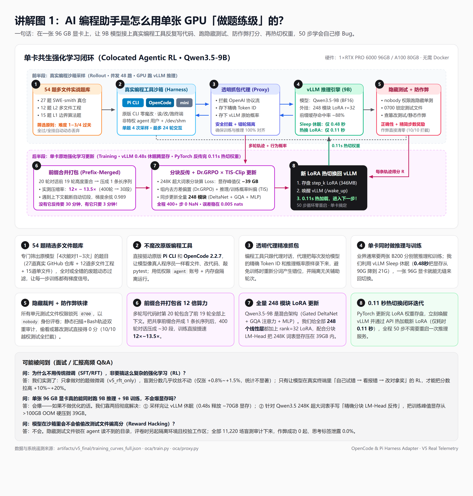
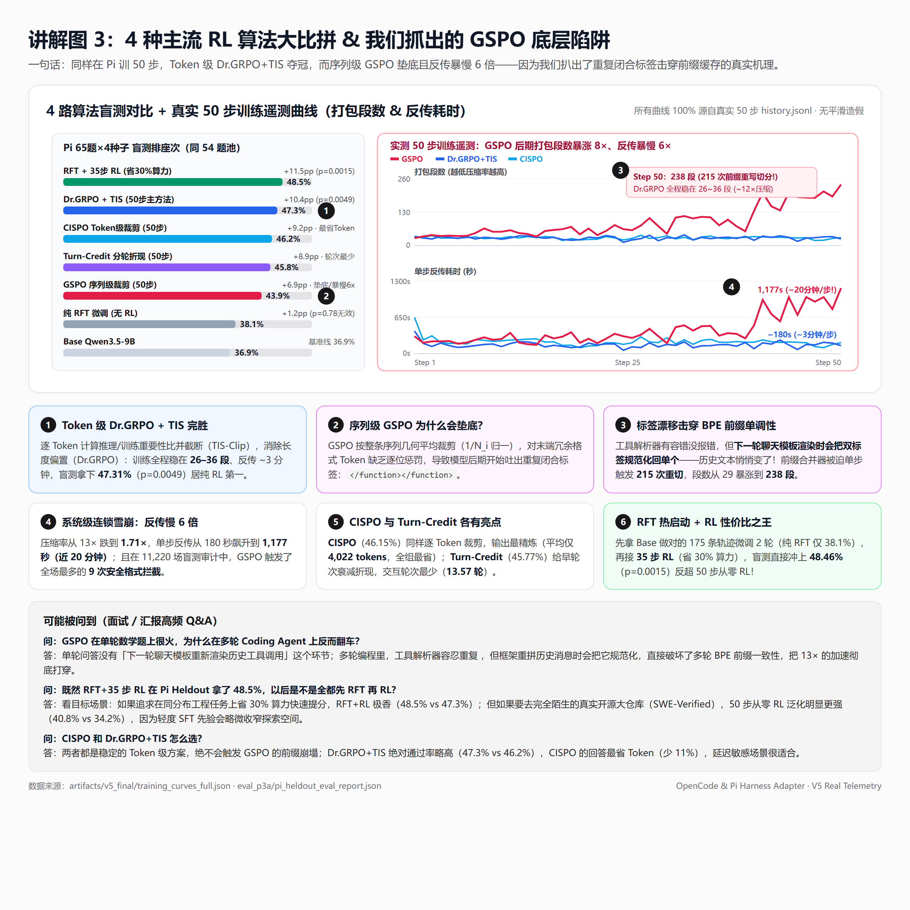
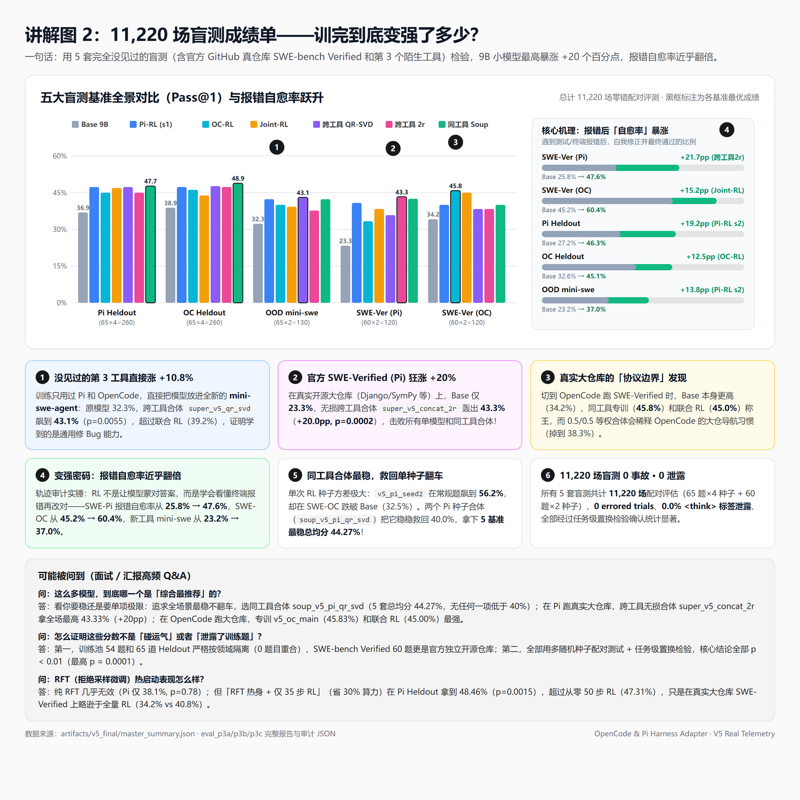
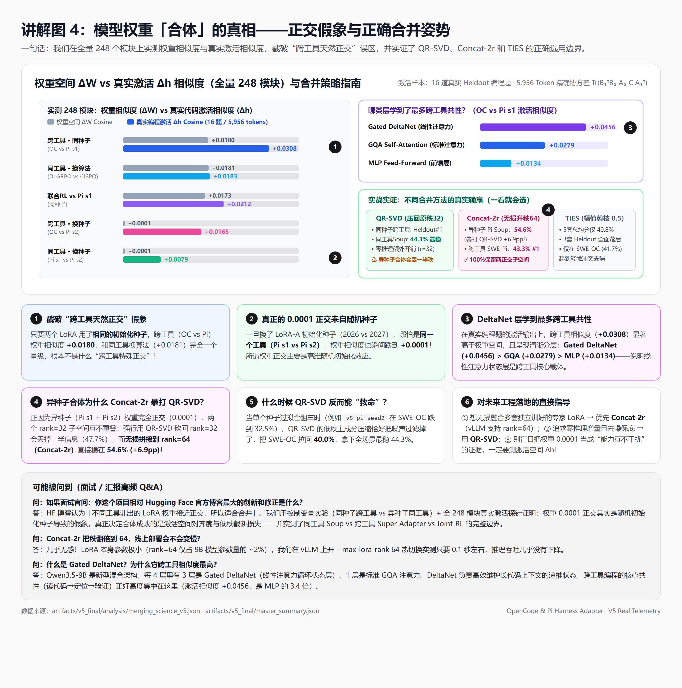

# OpenCode & Pi Harness Adapter (V5): Full Technical Report

**Single-GPU Colocated Agentic RL, Multi-Harness Zero-Shot Transfer, Mechanistic GSPO Prefix-Shattering, and 248-Module Weight-vs-Activation Merging Science on Qwen3.5-9B**

- **Codebase**: [XDE10/opencode-harness-adapter](https://github.com/XDE10/opencode-harness-adapter) (`feat/v5-algo-infra-upgrade`)
- **HuggingFace Weights & Artifacts**: [`XDE10/Qwen3.5-9B-Harness-Adapters-v5`](https://huggingface.co/XDE10/Qwen3.5-9B-Harness-Adapters-v5) (8 curated LoRA adapters, 4 Retina explainers, full JSON evaluation & audit suites)
- **Chinese Visual Explainer**: [docs/V5_EXPLAINER_ZH.md](V5_EXPLAINER_ZH.md)

---

## Abstract

Adapting compact open-weight models (`Qwen/Qwen3.5-9B`, non-thinking mode) to operate unmodified terminal coding harnesses via Reinforcement Learning typically requires multi-GPU asynchronous clusters (e.g., 2×B200 + Docker/Harbor). In this report, we present **V5**, a self-contained **single-GPU colocated Agentic RL** system (`1×96 GB` RTX PRO 6000 Blackwell or `1×80 GB` A100, zero Docker) that adapts all **248 linear modules** (Gated DeltaNet + GQA + MLP, LoRA `r=32`) with `0.48s` vLLM sleep offloading, `0.11s` runtime LoRA hot-swapping, `12×–13.5×` prefix-merged multi-turn packing, and exact chunked 248K-vocab LM-head backward (`~39–42 GiB` peak VRAM).

Across **11,220 paired evaluation trials (0 errored trials, 0.0% `<think>` leakage, 0 reward-hacking successes)** spanning **5 benchmark suites** and **3 terminal coding harnesses** (`Pi CLI 0.73.1`, `OpenCode 2.2.7`, and the unseen 3rd OOD harness `mini-swe-agent v2`), our controlled evaluation yields five grounded findings:
1. **Robust Multi-Suite Improvement (Primary Metric)**: Without cherry-picking per-benchmark winners, the most balanced single adapter — Same-Harness Soup (`soup_v5_pi_qr_svd`) — raises the **5-suite mean from `33.12% → 44.27%` (`+11.15 pp`)**, outperforming Base on every suite (`40.00%–48.85%`); single-run `v5_pi_drgrpo_tis` reaches `43.55%` (`+10.43 pp`). On the unseen 3rd harness `mini-swe-agent`, Pi-trained adapters transfer zero-shot by **`+10.0 to +12.3 pp`** (`32.31% → 42.31%–44.62%`, `p ≤ 0.0055`). Per-suite peaks on our zero-Docker 60-task pure-Python `SWE-bench_Verified` subset (`django` 36 / `sympy` 22 / `requests` 2) reach `43.33%` on Pi (`+20.00 pp`, `super_v5_concat_2r`) and `45.83%` on OpenCode (`+11.67 pp`, `v5_oc_main`), though single-suite peaks carry selection bias and wide confidence intervals.
2. **Negative/Neutral Finding on Cross-Harness Super-Adapters & Seed-Variance Rescue**: Contrary to the "1+1>2 cross-harness synergy" hypothesis, all three equal-weight 0.5/0.5 cross-harness merges (`super_*`: `40.76%–42.45%` 5-suite mean) trail single-harness `v5_pi_drgrpo_tis` (`43.55%`), Same-Harness Soup `soup_v5_pi_qr_svd` (`44.27%`), and Joint RL `v5_joint_oc_pi` (`42.67%`). Conversely, Same-Harness Soup resolves severe single-seed instability: `v5_pi_seed2` achieves the highest mean (`45.22%`) yet collapses below Base on `SWE-Verified (OC)` (`32.50%` vs `34.17%`), which `soup_v5_pi_qr_svd` recovers to `40.00%`.
3. **GSPO Prefix-Shattering Observation (Hypothesis Pending Causal Retrain)**: In a single-seed 4-way ablation, sequence-level **`GSPO`** ranks lowest (`43.85%`, n.s.) and slows backward passes **5–6× (`180s → 1,177s`)**, with packed segments surging `29 → 238` (`215` rewrite splits). Inspection points to redundant `</function></function>` closing tags canonicalized by Qwen's chat template on subsequent turns; a clean-tag retrain ablation is still needed to establish strict causality, and the 4-way score spread (`43.85%–47.31%`) lies within single-seed variance (`8.84 pp`).
4. **Refuting Cross-Harness Weight Orthogonality (Strong) vs Weak Activation Signal (Modest)**: Across 248 modules, near-zero weight cosine (`+0.0001`) is demonstrably a **LoRA-A initialization-seed artifact** (same-harness different-seed `Pi s1 vs Pi s2` is also `+0.0001`, while same-seed cross-harness `OC vs Pi s1` is `+0.0180`). On 16 heldout prompts, activation-space cosine shows a small positive shift (`mean Δh cos = +0.0308`, median `+0.0155`, range `[-0.238, +0.490]`, highest in DeltaNet `+0.0456` vs MLP `+0.0134`); given the small absolute magnitude and lack of null-distribution testing, we treat this as a weak directional observation rather than strong functional alignment.
5. **Behavioral Attribution & Weight-Norm Correlation**: Trajectory audits show RL primarily improves **tool-use discipline** — raising Error Recovery Rate (`25.8% → 47.6%` on `SWE-Pi`, `45.2% → 60.4%` on `SWE-OC`) and structured `edit` share (`1.5% → 5.3%`). SFT/RFT shifts Frobenius weight norm `1.8×–2.0×` farther from Base than on-policy RL (`0.253` vs `0.132`), correlating with RFT+RL's stronger in-distribution efficiency alongside weaker OOD repo transfer.

---

## 1. Datasets, Isolation Protocol, and Harness Suite

### 1.1 54-Task Multi-File RL Training Pool (`protocol/screen_v5_multifile.json`)
To maximize per-step GRPO variance (avoiding all-pass or all-fail zero-advantage groups), we screened multi-file repositories with `Base Qwen3.5-9B` and froze a **54-task informative pool** (`72.2%` multi-file):
- **27 `SWE-smith-py`** real open-source Python repository bugfix tasks with upstream `pytest` suites;
- **12 L2 `repo_pytest`** 3–4 file synthetic engineering repositories verified by automated triple-control pytest harnesses;
- **15 L1 `single_file`** edge-case algorithmic/state-machine tasks.

During training, dynamic oversampling (`1.5×`), `filter_same_correctness=True`, and `early_cutoff=True` guarantee 6 non-degenerate groups per update step while cancelling straggler rollouts.

### 1.2 Strictly Domain-Isolated Evaluation Suites (11,220 Paired Trials)

| Suite | Benchmark Composition | Harness | Seeds | Trials/Arm | Arms | Total Trials (Errors) |
| :--- | :--- | :--- | :-: | :-: | :-: | :-: |
| `pi_heldout` | 65 domain-disjoint heldout tasks (L1 single-file + L2 `repo_pytest` + L3 real OSS commits) | Pi CLI `0.73.1` | 4 (`101–104`) | 260 | 15 | `3,900` (`0`) |
| `oc_heldout` | Same 65 strictly heldout tasks | OpenCode `2.2.7` | 4 (`101–104`) | 260 | 12 | `3,120` (`0`) |
| `mini_swe_heldout` | Same 65 heldout tasks on **completely unseen 3rd harness** | `mini-swe-agent v2` | 2 (`101–102`) | 130 | 12 | `1,560` (`0`) |
| `swe_verified_pi` | Zero-Docker pure-Python 60-task `SWE-bench_Verified` subset (`django` 36, `sympy` 22, `requests` 2) | Pi CLI `0.73.1` | 2 (`101–102`) | 120 | 12 | `1,440` (`0`) |
| `swe_verified_oc` | Same zero-Docker pure-Python 60-task `SWE-bench_Verified` subset | OpenCode `2.2.7` | 2 (`101–102`) | 120 | 10 | `1,200` (`0`) |
| **Total** | — | **3 Unmodified CLIs** | — | — | — | **`11,220` (`0`)** |

*Leakage & Grader Audit*: Programmatic verification confirms **0 task-ID, 0 domain, and 0 repository overlap** between the 54-task training pool (9 SWE-smith repos: `sqlparse`, `bottle`, `chardet`, `textfsm`, `tomli`, `tenacity`, `schema`, `python-string-similarity`, `oauthlib` + 27 local L1/L2 tasks; Step-0 Base `pass@1 = 43.52%`) and both heldout suites (`65` heldout + `60` SWE-Verified / all 12 official SWE-Verified repos). Every SWE-Verified task passed a `base=fail / gold=pass` gate and requires `returncode == 0 and total > 0 and passed == total` (blocking empty-patch or zero-test false positives). However, our zero-Docker setup introduces three explicit boundaries: (1) 96.7% repo skew toward Django and SymPy; (2) a shared Python 3.11 venv per repo; and (3) capped regression tests (`p2p[:25]`, `-k` capped at 30 targets in `oca/benchmarks/swe_verified.py`) for `pytest` repos rather than full official Docker regression suites.

*Engineering note on `mini-swe-agent v2`*: We patched [oca/harnesses/mini_swe.py](../oca/harnesses/mini_swe.py) (commit `5056d43`) to suppress v2's interactive first-run wizard (`MSWEA_CONFIGURED=true`) and layer overrides cleanly on top of built-in `mini.yaml`, verified via 26 unit tests and a live 1-trial smoke check (`capture_ok=true`, `10` policy turns, `7/7` tests passed in `31.8s`).

---

## 2. Single-GPU Colocated RL Architecture & Protocol

### 2.1 Five Key Systems Engineering Primitives
1. **Sub-Second Colocation (`vLLM Sleep` + Runtime LoRA Hot-Swap)**: During rollout, vLLM serves BF16 `Qwen3.5-9B` (`~91 GiB` VRAM, concurrency `48`, prefix-cache hit rate `~88%`). Before backward, `/sleep?level=1` offloads KV/weights in **`0.48s`** (`91.0 → 21.6 GiB`); after updating LoRA weights in PyTorch, `/wake_up` + `/v1/load_lora_adapter` hot-swaps the new adapter in **`0.10–0.12s`** (`0` vLLM restarts across 400+ steps).
2. **Engine-Boundary `CaptureProxy` (`oca/proxy.py`)**: Sits transparently between unmodified CLIs and vLLM, capturing exact `return_token_ids` and `processed_logprobs` from the serving engine, isolating non-policy auxiliary calls (e.g., OpenCode title summarizers), and enforcing `safe_intercept=True`.
3. **Prefix-Merged Multi-Turn Packing (`oca/train.py`)**: Merges monotonic multi-turn histories into packed super-sequences (**`12.2×–13.0×`** compression on Pi: `~400` turns → `~31` segments; gradient cosine `0.989`), automatically splitting segments when a harness rewrites or compacts prior context.
4. **Exact Chunked LM-Head Backward**: Computes exact cross-entropy/logprob gradients in `2048`-token chunks across Qwen3.5's 248K vocabulary (`max_lp_diff = 0.000e+00`), capping peak training VRAM at **`40.5–42.1 GiB`** (vs `>100 GiB` OOM unchunked).
5. **Full 248-Module Hybrid-Architecture LoRA**: Adapts all GQA (`q/k/v/o_proj`), MLP (`gate/up/down_proj`), and **Gated DeltaNet** (`in_proj_qkv/z/b/a`, `out_proj`) projections (`r=32, alpha=64`, `346 MB` per checkpoint).

### 2.2 Frozen Hyperparameters (`protocol/oca-v5.json`)

| Category | Parameters |
| :--- | :--- |
| **Model & LoRA** | `Qwen/Qwen3.5-9B` (BF16, `enable_thinking=False`, `qwen3_coder`), 248-module LoRA `r=32, alpha=64` (`max_lora_rank=64`), default init seed `2026` (`v5_pi_seed2`: `2027`) |
| **Rollout & Sandbox** | `temp=0.8`, `top_p=1.0`, `max_ctx=32768`, `max_out/call=2048`, `max_out/trial=10240`, `max_calls=24`, `timeout=300s`, `/dev/shm` workdir, unprivileged `agent` UID + `bwrap`, hidden `0700` tests graded as `nobody` |
| **Reward & Anti-Hack** | Binary hidden test pass + efficiency bonus (`eff_w=0.05`, budget `24` turns / `8192` tok) + static/bash/test-tamper zeroing (`10/10` adversarial exploits blocked) |
| **RL Optimization** | `50` steps (`35` for `v5_rft_plus_rl`), `6 tasks × 4 rollouts` (`1.5×` oversample), `minibatches=2`, `lr=2e-5`, `max_grad_norm=1.0`, `Dr.GRPO` + `TIS-Clip` (`tis_cap=2.0`, `clip_low=0.20`, `clip_high=0.28`), token-level normalization |

---

## 3. RL Algorithm Ablation, 7-Run Telemetry & GSPO Mechanism

### 3.1 Full 7-Run Training Telemetry (`artifacts/v5_final/training_curves_full.json`)

| Training Run | Steps | First-10 Pass | Last-10 Pass | Peak Pass | Packed Segs *(med/max)* | Med Comp | Max Rewrite Splits | Train Time *(med/max)* | LoRA Swap | Mean Logp Err | Peak VRAM | Wall Time |
| :--- | :-: | :-: | :-: | :-: | :-: | :-: | :-: | :-: | :-: | :-: | :-: | :-: |
| `v5_pi_drgrpo_tis` | 50 | `68.9%` | **`71.4%`** | **`90.9%`** | `31 / 42` | `12.21×` | `18` | `157s / 406s` | `0.104s` | `0.00505` | `40.7 GiB` | `8.11 h` |
| `v5_pi_cispo` | 50 | `62.1%` | `60.9%` | `81.2%` | `31 / 40` | **`12.97×`** | `17` | `205s / 652s` | `0.365s` | `0.00496` | `40.6 GiB` | `10.57 h` |
| `v5_pi_gspo` ⚠️ | 50 | `67.5%` | `60.4%` | `82.5%` | **`67 / 238`** | **`5.58×`** *(1.71×)* | **`215`** | **`319s / 1177s`** | `0.103s` | `0.00498` | `42.1 GiB` | `11.44 h` |
| `v5_pi_turn_credit` | 50 | `70.1%` | `69.9%` | `85.4%` | `32 / 47` | `10.84×` | `23` | `157s / 219s` | `0.120s` | `0.00486` | `40.9 GiB` | `8.10 h` |
| `v5_oc_main` | 50 | `56.8%` | `67.1%` | `87.5%` | `66 / 135` | `5.72×` | `111` | `377s / 816s` | `0.112s` | `0.00507` | `40.5 GiB` | `11.65 h` |
| `v5_joint_oc_pi` | 50 | `50.3%` | `56.1%` | `72.7%` | `42 / 62` | `8.79×` | `38` | `281s / 446s` | `0.441s` | `0.00534` | `40.5 GiB` | `12.90 h` |
| `v5_rft_plus_rl` | 35 | `69.3%` | `70.9%` | `80.8%` | `32 / 45` | `11.76×` | `21` | `171s / 255s` | `0.106s` | `0.00440` | `40.6 GiB` | **`5.75 h`** |

*(An 8th run, `v5_pi_seed2`, trained 50 steps on an 80 GB A100 with `lora_init_seed=2027` and rollout `seed=102`, peaking at `79.2%` with `24–40` packed segments. Note on flat training curves: Base `pass@1` across all 54 training tasks at Step 0 is **`43.52%`** (`protocol/screen_v5_multifile.json`). Logged per-step `pass_rate` starts near `50%–70%` and appears relatively flat over steps 1–50 primarily because `early_cutoff=True` with `1.5×` oversampling cancels slower straggler groups once 6 informative groups finish, introducing survivor bias toward faster/easier groups alongside high small-batch variance.)*

### 3.2 GSPO Degradation Observation & Hypothesis
On the single-seed Pi 4-way ablation (`pi_heldout`, 260 trials/arm):
- **`Dr.GRPO + TIS`**: **`47.31%`** (`+10.38 pp`, `p=0.0049`, `pass@4=69.23%`, `+17.3%` common-solved token savings)
- **`CISPO`**: `46.15%` (`+9.23 pp`, `p=0.0247`, **shortest mean tokens `4,022`**, **`+31.66%` common-solved token savings**)
- **`Turn-Credit`**: `45.77%` (`+8.85 pp`, `p=0.0164`, **fewest mean turns `13.57`**)
- **`GSPO`**: **`43.85%`** (`+6.92 pp`, `p=0.0677` n.s., lowest of the 4 RL runs)

**Hypothesized Mechanism & Caveats**: Because GSPO normalizes log-ratios across the entire sequence ($1/N_i$), redundant end-of-turn closing tokens (`</function>\n</function>\n</tool_call>`) receive diluted per-token penalties. Tolerant tool parsers execute the tool call without error, but on the subsequent turn Qwen's chat template re-renders the historical tool call into canonical single-tag form (`</function>\n</tool_call>`), violating multi-turn BPE prefix monotonicity (`215` rewrite splits at step 50, `29 → 238` segments, `1.71×` compression, `1,177s` backward pass) and correlating with the highest safe-intercept count (`9`). Caveats: (a) strict causality requires a follow-up retrain with tag canonicalization; (b) the 5–6× slowdown is specific to prefix-merged packing and default untuned GSPO clipping (`[0.997, 1.004]`); (c) the `3.46 pp` spread across the 4 algorithms is smaller than single-seed variance (`8.84 pp`), preventing definitive algorithm ranking.

---

## 4. Complete 11,220-Trial Evaluation Results

### 4.1 5-Benchmark Master Table (`Pass@1`, Task-Level Permutation `p`, 0 Errored Trials)

| Adapter / Method | **5-Suite Mean** | 3-Heldout Mean | 2-SWE Mean | Pi Heldout *(65×4)* | OC Heldout *(65×4)* | OOD `mini-swe` *(65×2)* | SWE-Verified Pi *(60×2)* | SWE-Verified OC *(60×2)* |
| :--- | :---: | :---: | :---: | :---: | :---: | :---: | :---: | :---: |
| `Base Qwen3.5-9B` | `33.12%` | `36.03%` | `28.75%` | `36.92%` | `38.85%` | `32.31%` | `23.33%` | `34.17%` |
| `v5_pi_seed2` | **`45.22%`** | **`50.64%`** | `37.09%` | **`56.15%`** *(p=.0001)* | **`51.15%`** *(p=.0018)* | **`44.62%`** *(p=.0018)* | `41.67%` *(p=.0003)* | `32.50%` *(p=.865)* |
| **`soup_v5_pi_qr_svd`** | **`44.27%`** | `46.28%` | `41.25%` | `47.69%` *(p=.0022)* | `48.85%` *(p=.0135)* | `42.31%` *(p=.0387)* | `42.50%` *(p=.0007)* | `40.00%` *(p=.347)* |
| `v5_pi_drgrpo_tis` | `43.55%` | `45.64%` | `40.41%` | `47.31%` *(p=.0049)* | `47.31%` *(p=.0121)* | `42.31%` *(p=.0049)* | `40.83%` *(p=.0003)* | `40.00%` *(p=.209)* |
| `soup_v5_pi_concat_2r` | `43.05%` | `47.31%` | `36.66%` | `54.62%` *(p=.0001)* | `45.77%` *(p=.0945)* | `41.54%` *(p=.0117)* | `40.00%` *(p=.0009)* | `33.33%` *(p=1.00)* |
| `v5_joint_oc_pi` | `42.67%` | `43.33%` | **`41.66%`** | `46.92%` *(p=.0087)* | `43.85%` *(p=.1645)* | `39.23%` *(p=.0479)* | `38.33%` *(p=.0057)* | `45.00%` *(p=.0298)* |
| `super_v5_qr_svd` | `42.45%` | `46.03%` | `37.08%` | `47.31%` *(p=.0050)* | `47.69%` *(p=.0054)* | `43.08%` *(p=.0055)* | `35.83%` *(p=.0353)* | `38.33%` *(p=.494)* |
| `super_v5_concat_2r` | `42.33%` | `43.33%` | `40.83%` | `45.00%` *(p=.0499)* | `47.31%` *(p=.0062)* | `37.69%` *(p=.0654)* | **`43.33%`** *(p=.0002)* | `38.33%` *(p=.471)* |
| `v5_oc_main` | `42.06%` | `43.72%` | `39.58%` | `45.00%` *(p=.0232)* | `46.15%` *(p=.0621)* | `40.00%` *(p=.0529)* | `33.33%` *(p=.0781)* | **`45.83%`** *(p=.0057)* |
| `super_v5_ties` | `40.76%` | `41.54%` | `39.59%` | `41.54%` *(p=.0584)* | `45.38%` *(p=.0196)* | `37.69%` *(p=.2349)* | `37.50%` *(p=.0042)* | `41.67%` *(p=.144)* |
| `v5_rft_plus_rl` *(35 RL)* | — | `44.61%` | — | `48.46%` *(p=.0015)* | `46.92%` *(p=.0151)* | `38.46%` *(p=.076)* | `34.17%` *(p=.0212)* | — |
| `v5_rft_only` | — | `37.18%` | — | `38.08%` *(p=.777)* | `39.62%` *(p=.903)* | `33.85%` *(p=.835)* | `26.67%` *(p=.557)* | — |

**Key Structural Interpretation (Super-Adapter Negative Result & Soup Variance Rescue)**:
- **Same-Harness Soup Rescues Single-Seed Collapse**: `v5_pi_seed2` achieves the highest 5-suite mean (`45.22%`) yet regresses below Base on `SWE-Verified (OC)` (`32.50%` vs `34.17%`). Merging the two Pi seeds via `QR-SVD` (`soup_v5_pi_qr_svd`, `44.27%`) recovers `SWE-OC` to `40.00%`, delivering the most balanced adapter with consistent gains over Base across all 5 suites.
- **Equal-Weight Cross-Harness Super-Adapters Do Not Beat Single-Harness Pi or Soup**: All three `super_*` merges (`40.76%–42.45%`) underperform `soup_v5_pi_qr_svd` (`44.27%`), single-run `v5_pi_drgrpo_tis` (`43.55%`), and `v5_joint_oc_pi` (`42.67%`) on 5-suite mean. Because `v5_oc_main` (`42.06%`) transfers less broadly, 0.5/0.5 averaging neither preserves OpenCode's `SWE-OC` peak (`45.83% → 38.33%`) nor improves Pi's general debugging policy. This aligns with Section 5: RL primarily instills harness-agnostic debugging/tool discipline, so single-harness Pi training already transfers well without cross-harness skill composition.

### 4.2 Granular Tier Breakdowns (`repo_pytest` vs `single_file`), `pass@k`, and Paired Wins/Losses
- **Multi-file `repo_pytest` gains dominate across every harness**:
  - `pi_heldout`: `12.1% (Base) → 24.1%` (`v5_pi_drgrpo_tis`, `2.0×`) → **`32.8%`** (`soup_v5_pi_concat_2r`, `2.7×`); `pass@4` climbs from `55.38% → 69.23%–72.31%`.
  - `oc_heldout`: `12.1% (Base) → 21.6%` (`soup_v5_pi_qr_svd`) → **`26.7%`** (`v5_pi_seed2`, `2.2×`); `pass@4` climbs from `55.38% → 66.15%–67.69%`.
  - Unseen `mini_swe_heldout`: `1.7% (Base) → 10.3%` (`v5_pi_drgrpo_tis`, `6.0×`) → **`13.8%`** (`super_v5_qr_svd`, **`8.1×`**); `pass@2` climbs from `36.92% → 55.38%` (`+18.46 pp`).
- **Official `SWE-bench_Verified` paired outcomes**:
  - `swe_verified_pi`: `super_v5_concat_2r` achieves **`28 wins / 4 losses`** (`7:1`), `pass@2 = 53.33%` (vs `31.67%` Base), cutting common-solved tokens by **`-13.55%`**.
  - `swe_verified_oc`: `v5_oc_main` achieves **`18 wins / 4 losses`** (`4.5:1`, `pass@2 = 55.00%`), while `v5_joint_oc_pi` reaches **`pass@2 = 56.67%`** (`20 wins / 7 losses`).

---

## 5. Trajectory & Behavioral Audit (11,220 Trials)

Auditing every trajectory via `oca/audit_trajectories.py` establishes three clean behavioral findings:
1. **Cleanliness & Integrity**: `0.0%` `<think>` tag leakage across all 11,220 trials; `0` reward-hacking successes.
2. **Error Recovery Rate Nearly Doubles**:
   - `SWE-Verified (Pi)`: `25.8% (Base) → 45.1% (v5_pi_drgrpo_tis) → 47.6% (super_v5_concat_2r)` (`+21.8 pp`)
   - `SWE-Verified (OC)`: `45.2% (Base) → 55.6% (v5_oc_main) → 60.4% (v5_joint_oc_pi)` (`+15.2 pp`)
   - `Pi Heldout`: `27.2% (Base) → 37.8% (super_v5_qr_svd) → 46.3% (v5_pi_seed2)` (`+19.1 pp`)
   - `OOD mini-swe`: `23.2% (Base) → 33.3% (v5_pi_drgrpo_tis) → 37.0% (v5_pi_seed2)` (`+13.8 pp`)
3. **Tool-Use & Failure-Taxonomy Shift on `SWE-Verified (Pi)`**:
   - `Base` spends `77.7%` of tool calls looping in `bash` and only **`1.5%`** on structured `edit`, suffering `81/120` `budget_or_timeout` failures (`28` solved).
   - `v5_pi_drgrpo_tis` reduces `bash` to `69.0%`, raises `read` to `25.5%`, and increases structured **`edit` share 3.5× (`1.5% → 5.3%`)**; `super_v5_concat_2r` cuts `budget_or_timeout` failures by **`-28.4%`** (`81 → 58`) while nearly doubling solved trials (`28 → 52`).

---

## 6. 248-Module Merging Science: Weight ($\Delta W$), Activation ($\Delta h$), and Weight Geometry

### 6.1 Exact Activation Covariance vs Weight Cosine
We collected input activation covariance matrices $C_m = \frac{1}{N} X_m^\top X_m$ across all **248 LoRA modules** over 16 heldout coding prompts (`5,956` tokens/module) on base `Qwen3.5-9B`, computing exact $\cos(\Delta W_1, \Delta W_2)$ and $\cos(\Delta W_1 X, \Delta W_2 X)$ via $\mathrm{Tr}((B_1^\top B_2)(A_2 C_m A_1^\top))$:

| Adapter Pair | Init Seed Match | $\Delta W$ All | DeltaNet $\Delta W$ | GQA $\Delta W$ | MLP $\Delta W$ | **$\Delta h$ All** | **DeltaNet $\Delta h$** | **GQA $\Delta h$** | **MLP $\Delta h$** |
| :--- | :---: | :---: | :---: | :---: | :---: | :---: | :---: | :---: | :---: |
| `OC` vs `Pi s1` (Cross-Harness) | Same (`2026`) | `+0.0180` | `+0.0245` | `+0.0188` | `+0.0095` | **`+0.0308`** | **`+0.0456`** | `+0.0279` | `+0.0134` |
| `Dr.GRPO` vs `CISPO` (Same-Harness) | Same (`2026`) | `+0.0181` | `+0.0172` | `+0.0218` | `+0.0179` | `+0.0183` | `+0.0135` | `+0.0308` | `+0.0201` |
| `Dr.GRPO` vs `Turn-Credit` | Same (`2026`) | `+0.0184` | `+0.0226` | `+0.0079` | `+0.0168` | `+0.0163` | `+0.0190` | `+0.0071` | `+0.0161` |
| `Joint` vs `Pi s1` | Same (`2026`) | `+0.0173` | `+0.0164` | `+0.0168` | `+0.0186` | `+0.0212` | `+0.0204` | `+0.0234` | `+0.0215` |
| `OC` vs `Pi s2` (Cross-Harness) | Diff (`26/27`) | `+0.0001` | `+0.0001` | `+0.0001` | `+0.0001` | **`+0.0165`** | `+0.0178` | `+0.0201` | `+0.0138` |
| `Pi s1` vs `Pi s2` (Same-Harness) | Diff (`26/27`) | **`+0.0001`** | `+0.0002` | `+0.0001` | `+0.0001` | `+0.0079` | `+0.0023` | `+0.0172` | `+0.0119` |

### 6.2 Adapter Weight Geometry (Frobenius Norms & Effective Rank)

| Adapter | Mean Frob (DeltaNet) | Mean Frob (GQA) | Mean Frob (MLP) | Mean Effective Rank (of 32) |
| :--- | :---: | :---: | :---: | :---: |
| Pure RL runs (`v5_oc_main`, `v5_pi_*`, `v5_joint_oc_pi`) | `0.060–0.065` | `0.073–0.078` | `0.126–0.135` | `16.13–16.45` |
| `v5_rft_only` (2-epoch SFT on 175 trajectories) | **`0.108`** | **`0.132`** | **`0.227`** *(1.8× RL)* | `17.64` |
| `v5_rft_plus_rl` (RFT + 35-step RL) | **`0.121`** | **`0.147`** | **`0.253`** *(2.0× RL)* | `17.23` |

**Key Takeaways & Boundaries**:
- **Weight orthogonality is seed-driven (strong); activation alignment is weak (modest)**: Under 50-step small-LR updates (`lr=2e-5`, Frobenius norms `~0.06–0.13`), changing the LoRA-A init seed collapses even same-harness $\Delta W$ cosine to `+0.0001`, cleanly refuting cross-harness weight orthogonality. In activation space (16 heldout prompts), `OC vs Pi s1` shows `mean Δh cos = +0.0308` (median `+0.0155`, layer range `[-0.238, +0.490]`, with DeltaNet `+0.0456` > GQA `+0.0279` > MLP `+0.0134`). Because `0.03` is very small in absolute terms and lacks null-distribution significance testing, we report it as a weak positive shift rather than claiming strong alignment or DeltaNet causality (which requires layer-selective merge ablations).
- **Rank-truncation vs denoising trade-off**: Merging orthogonal diff-seed adapters (`Pi s1 + Pi s2`) with rank-32 `QR-SVD` sacrifices `-6.93 pp` vs lossless rank-64 `Concat-2r` on `pi_heldout` (`47.69%` vs `54.62%`), yet `QR-SVD`'s low-rank compression denoises `seed2`'s OOD failure on `SWE-OC` (`32.50% → 40.00%`) to deliver the best balanced 5-suite mean (`44.27%`).
- **Geometric correlation for RFT vs RL**: SFT moves `1.8×–2.0×` farther from Base in Frobenius norm than 50-step on-policy RL (`0.253` vs `0.132`), correlating with `v5_rft_plus_rl`'s strong in-distribution efficiency (`48.46%` on `pi_heldout` with 30% fewer RL steps) alongside weaker OOD repo transfer (`34.17%` vs `40.83%` on `SWE-Verified Pi`); this remains a correlational observation rather than causal proof.

---

## 7. Threats to Validity, Limitations & Future Work

1. **High Single-Seed Variance Exceeds Most Inter-Algorithm Gaps**: `v5_pi_seed2` reaches `56.15%` on `pi_heldout` yet drops below Base (`32.50%`) on `swe_verified_oc`. Differences of `2–5 pp` from single-seed runs cannot support definitive method ranking; multi-seed repetition (`≥3` seeds) and multi-suite means are essential.
2. **Zero-Docker `SWE-bench_Verified` Boundaries & Independent Official Docker Cross-Repo Spot-Check**: Our 60-task subset is 96.7% skewed toward `django` (36) and `sympy` (22) (plus 2 `requests`), runs in shared Python 3.11 venvs, and truncates `pytest` regressions to `p2p[:25]` (`-k` capped at 30 targets). To audit this boundary directly, we added unified `git diff` (`predictions.jsonl`) export to `oca/rollout.py` and `oca/eval.py`, re-ran 3 core arms on Pi (360 trials, 0 errors: `base` `26.67%` → `v5_pi_seed2` `41.67%` → `soup_v5_pi_qr_svd` `49.17%`, `+22.50 pp`, `p=0.0001`), and verified **6 cross-repo tasks** (`django__django-16116`, `django__django-16255`, `sympy__sympy-24066`, `sympy__sympy-22714`, `sympy__sympy-23262`, `psf__requests-5414`; **34 clean paired trials**, excluding 2 `Django.egg-info/SOURCES.txt` 256 KB truncated exports—now fixed in `oca/rollout.py`) inside official local `SWE-bench_Verified` Docker containers:
   - **Core repos (`django` + `sympy`, 96.7% of the subset)**: **28/28 (100.0%) exact agreement** (all **16/16** Colab-PASS trials confirmed `RESOLVED`, including `soup_v5_pi_qr_svd` **8/8 `RESOLVED`** vs `base` **0/7** across the 4 Base-failing tasks).
   - **Minor repo (`psf/requests`, 3.3% / 2 of 60 tasks)**: caught **1 genuine `p2p[:25]` false-positive task** (`psf__requests-5414`, 3 trials: `soup` ×2, `seed2` ×1) where removing `if not unicode_is_ascii(host):` passed `FAIL_TO_PASS` and `p2p[:25]` but failed 8 later `TestPreparingURLs` regression tests (IPv6, punycode `xn--`, `http+unix://`) in official Docker. Overall 6-task agreement is **31/34 (91.2%)** (`16/19 = 84.2%` Colab-PASS confirmed). This validates that the core RL gains are genuine while empirically exposing the exact mechanism of `p2p[:25]` regression leakage; full-scale official Docker/Harbor evaluation remains a V6 priority.
3. **Incomplete Matrix, Sampling Variance & Non-Thinking Regime**: `gspo`/`cispo`/`turn_credit` were evaluated only on `pi_heldout`, and RFT arms omitted `swe_verified_oc`. Evaluation used `temperature=0.8` with 2 seeds on SWE (`0.83%` per trial). All V5 runs used `enable_thinking=False` (motivated by our historical V4 control on OpenCode 65-task heldout under a fixed `10,240`-token trial budget, where enabling thinking raised tokens `+85.9%` for `+0.00 pp` `pass@1` and `-6.16 pp` `pass@4` due to budget truncation); marginal RL gains under larger budgets with adaptive thinking remain future work.
4. **Equal-Weight Cross-Harness Merging & Subprocess Memory Capping**: Equal-weight 0.5/0.5 cross-harness merging diluted OpenCode's `SWE-OC` advantage without beating Same-Harness Soup; asymmetric or layer-selective merging remains to be tested. In infrastructure, enforcing strict per-trial `RLIMIT_AS` on `agent` subprocesses will prevent runaway test-script RAM leaks during unattended runs.
